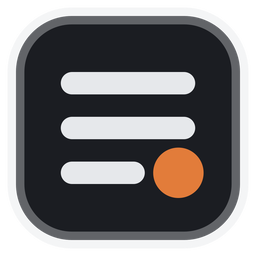
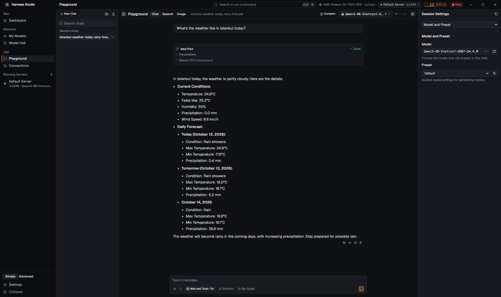
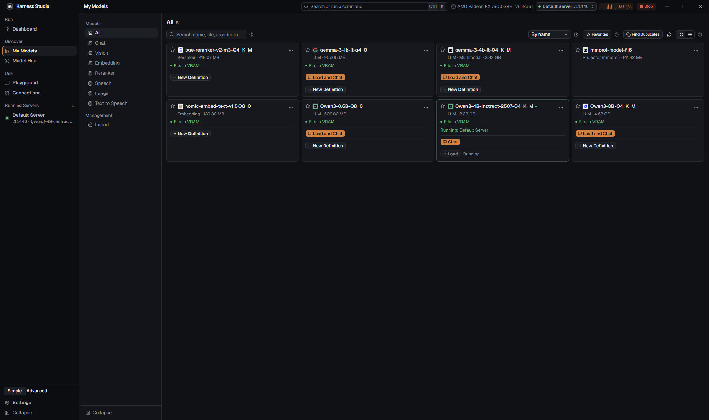
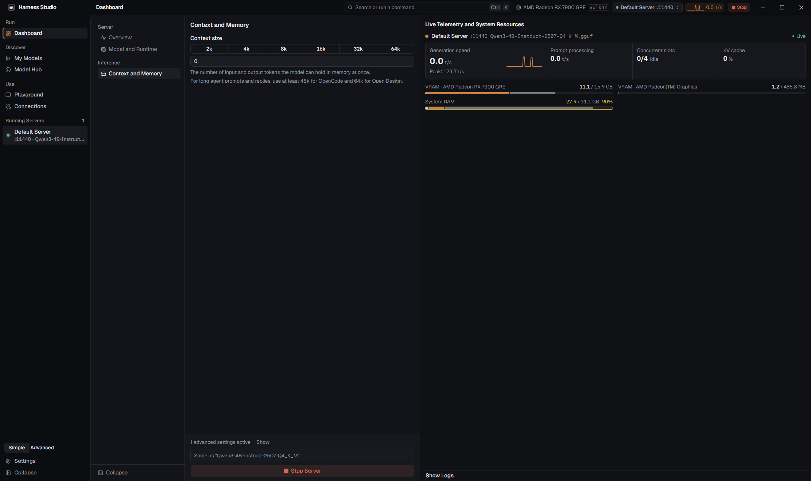

<div align="center">

**English** | [Türkçe](README.tr.md)



# Harness Studio

**Run AI models on your own computer. Private, free, and easy to use.**

[](https://github.com/struklabs/harness-studio/releases/latest)
[](https://github.com/struklabs/harness-studio/actions/workflows/ci.yml)
[](LICENSE)
[](https://github.com/struklabs/harness-studio/releases)
[](https://github.com/struklabs/harness-studio/discussions)

[](https://github.com/struklabs/harness-studio/stargazers)

[Download](https://github.com/struklabs/harness-studio/releases/latest) · [User guide](docs/guide/en/README.md) · [FAQ](#faq) · [Roadmap](docs/en/ROADMAP.md) · [Support the project](#how-you-can-support-the-project)

</div>



<p align="center">


</p>

*Screenshots are from the Windows app. The interface is available in English and Turkish.*

## Contents

- [What is Harness Studio?](#what-is-harness-studio)
- [Quick start in 3 steps](#quick-start-in-3-steps)
- [System requirements](#system-requirements) and [How big a model can my PC run?](#how-big-a-model-can-my-pc-run)
- [Features](#features)
- [Why Harness Studio? How it compares](#why-harness-studio-how-it-compares)
- [Privacy](#privacy)
- [For power users](#for-power-users)
- [FAQ](#faq)
- [Roadmap](#roadmap)
- [How you can support the project](#how-you-can-support-the-project)
- [Documentation](#documentation) · [Build from source](#build-from-source) · [License](#license)

## What is Harness Studio?

An AI chatbot such as ChatGPT normally runs on a company's computers: your words travel over the internet to get an answer. **Harness Studio lets you run the AI on your own computer instead.** You download a *model* (a file that holds the AI's "brain"), press a button, and chat. After the download, nothing has to leave your machine, there is no subscription, and it keeps working without internet.

You do not need to be a programmer. The app finds models for you, checks whether they fit your computer, downloads them, starts them, and gives you a chat window. If you *are* a programmer or power user, the same app is also a local AI server with an OpenAI-compatible API, a command line, and tool and MCP support, so your editor, coding tools, or scripts can use your local models.

Harness Studio is a desktop app built with Tauri, Rust, and Svelte. It manages the open-source engines that actually run the models (mainly [llama.cpp](https://github.com/ggml-org/llama.cpp)) and adds a friendly interface, safety checks, and measurements on top.

## Quick start in 3 steps

1. **Download and install.** Get the installer for your system from the [Releases page](https://github.com/struklabs/harness-studio/releases/latest). **Windows:** run `Harness.Studio_..._Windows_x64-setup.exe` (about 21 MB). The installer is **not code-signed yet**, so Windows SmartScreen may say "Windows protected your PC". Click **More info**, then **Run anyway**. **macOS:** open the DMG for your Mac (`Harness.Studio_..._macOS_Apple-Silicon.dmg` for Apple Silicon, about 29 MB; `Harness.Studio_..._macOS_Intel.dmg` for Intel, about 32 MB) and drag **Harness Studio** to **Applications**. The app is signed with an Apple Developer ID and notarized by Apple, so it opens like any other downloaded app. The source code and the build workflow are open in this repository.
2. **Follow the first-run wizard.** It looks at your hardware, asks where to keep models, installs the engine that runs them, and lets you choose your privacy settings. Pick the **Simple** interface level if you are new to this.
3. **Pick a model and chat.** In **Model Hub**, choose a recommended model that fits your computer (the app shows a fit estimate) and press **Download**. Then open **Dashboard**, select the model, press **Start Server**, open **Playground**, and say hello.

Step by step, with every screen explained: [User guide](docs/guide/en/README.md).

## System requirements

These are the requirements of **Harness Studio itself**, not of any model. Figures are measured on v0.1.0 on Windows and on macOS (Apple M1, 8 GB).

| | |
|---|---|
| **Operating system** | Windows 10 or 11, 64-bit, or macOS 13.3 or later on Apple Silicon (with Metal acceleration) or Intel (CPU only). Linux (x86_64, `.deb`) is a *preview*: tested on one Ubuntu machine so far. |
| **Installer size** | About 21 MB on Windows; on macOS the DMG is about 29 MB (Apple Silicon) or 32 MB (Intel) |
| **Installed size** | About 65 MB (about 64 MB on macOS). On top of that, the app downloads the model engines it needs on demand (a llama.cpp build is tens of MB; CUDA builds are larger). |
| **Memory used by the app** | About 250-350 MB of RAM for the app itself (interface plus WebView2), before any model is loaded. On macOS about 250 MB (interface plus WebKit). |
| **WebView2** | Preinstalled on Windows 11. On Windows 10 the installer sets it up automatically if it is missing (this needs an internet connection once). |
| **macOS** | A disk image (DMG): open it and drag the app to Applications. The app is signed with a Developer ID and notarized by Apple; microphone and Terminal-control permissions carry over to updates. |
| **Graphics card** | **Not required.** The CPU works. A GPU only makes models faster. |
| **Disk for models** | Depends on the model: from about 100 MB for a tiny model to 10 GB or more for a large one. You choose the folder, including another drive. |
| **Internet** | Needed to download the app, engines, and models. Not needed to chat once a model is on your disk. |

Supported acceleration, chosen automatically for your hardware: **CUDA** (NVIDIA), **ROCm/HIP** (recent AMD cards; on Windows this needs the HIP SDK libraries to be loadable, otherwise Vulkan is recommended), **SYCL** (Intel Arc), **Vulkan** (most other GPUs), **Metal** (Apple Silicon, with the macOS build), and **CPU**.

### How big a model can my PC run?

What matters is how much memory the *model* needs, which depends on its size and on how heavily it is compressed. Most people download *quantized* models in the **GGUF** format: a quantization (such as Q4_K_M) stores the model's numbers in a more compact form, so the file is much smaller for a small loss of quality. **VRAM** is your graphics card's own memory; if the whole model fits in it, the model runs fastest.

These are rough guides for quantized GGUF models. Real needs also grow with the *context* (how much text the model can keep in mind at once).

| Free memory (RAM, or VRAM on a GPU) | Models you can comfortably try |
|---|---|
| About 0.5 GB | Tiny models, 135M-360M parameters. For example **SmolLM2-135M**: a file of roughly 100-150 MB that runs with about 500 MB of RAM, so it works on almost any computer. |
| About 4 GB | Small models, 1B-3B |
| About 8 GB | Mid-size models, 4B-8B |
| 16 GB or more, or a GPU with 8 GB+ VRAM | 12B-14B models and above |

You do not have to work this out yourself. The Model Hub and the Dashboard show a hardware-fit hint next to each model (**Fits in VRAM**, **VRAM is tight**, **Partial GPU offload**, **Mostly CPU**, **May run out of memory**). When **Context size** and **GPU layers** are left on **Auto**, Harness Studio picks safe settings for you: on a small graphics card it prefers keeping every layer on the GPU and shrinking the context, and it refuses to load a request that cannot fit instead of running it painfully slowly. A second server uses only the layers that currently free GPU memory can hold; the rest run on the CPU. If a model still does not fit, a dialog explains what ran out and what to change.

## Features

- **Experimental text-to-speech with audio.cpp:** PocketTTS and other audio.cpp TTS GGUF families run in Playground and `/v1/audio/speech`. The engine is off by default; enable it under **Settings > Runtime > Installed Runtime > Other Runtimes** after confirming the risk notice. Platform builds use Vulkan, CUDA, Metal, or CPU. Voice embeddings appear in the speech picker; workers stop after five idle minutes.

Everything below works locally. Details are in the [user guide](docs/guide/en/README.md) and [FEATURES.md](docs/en/FEATURES.md).

### For everyday users

- **Model Hub:** search Hugging Face with filters, read model cards, see whether a model fits your hardware, and download through a resumable queue that verifies SHA-256 checksums.
- **Playground:** a chat window with saved conversations, side-by-side model comparison, Markdown and Mermaid diagrams, image input for vision models, documents with local search and citations (RAG), speech to text, read-aloud, and image generation.
- **Tools in chat:** models can use built-in file, web, and weather tools, with an approval step before anything risky runs.
- **Harness Link:** use the models of another Harness instance (address and inference token) in the Playground, My Models, and the gateway; see [Harness Link](docs/en/FEATURES.md#harness-link)
- **Simple and Advanced levels:** Simple shows only what a first-time user needs; Advanced reveals every setting. Switching never loses a setting ([details](docs/en/UI_LEVELS.md)).
- **Comfortable to use:** English and Turkish interface, light and dark themes, high-contrast and color-blind-friendly options, system tray, and launch at login.

### For developers and tool users

- **One local endpoint for many models** (the *gateway*): speaks the OpenAI, Anthropic, and Ollama APIs. Models load on first use and unload when idle. It is opt-in.
- **Guided setup for your tools:** Claude Code, Codex, OpenCode, Aider, Goose, Continue, Zed, VS Code, Cline, JetBrains, Open WebUI, and more, with a diff preview, backups, and one-click undo. `harness launch` starts a tool with the right settings and changes nothing global.
- **Tool calling that works with local models:** text-formatted tool calls are turned into real OpenAI-style `tool_calls`, so coding tools get usable results ([measurements](docs/en/COMPARISON.md)).
- **MCP both ways:** connect MCP servers to your chats, and let other tools use Harness itself as an MCP server.
- **Custom tools:** describe a tool and let a local model generate it as sandboxed JavaScript.

### For power users

- **Several servers at once** with profiles, automatic ports, memory estimates, live telemetry, and clear failure help (out of memory, missing libraries, port conflicts).
- **Full control of llama.cpp:** context, GPU layers, KV cache type, slots, sampling, and many more, plus a runtime registry with SHA-256-verified engines and per-server runtime choice. See the [CLI reference](docs/en/CLI.md).
- **Observability:** benchmarks, request analytics (P50/P95 latency, tokens, errors, per client), tool-call diagnosis, searchable logs, Prometheus `/metrics`, and optional OpenTelemetry export.
- **CLI, Control API, and headless mode:** the `harness` command, an authenticated Control API with an OpenAPI schema, and `harness serve` to run without a window. All of them share the same Rust code as the app.
- **More engines:** whisper.cpp, sherpa-onnx, ONNX Runtime, CrispASR, experimental audio.cpp (off by default), stable-diffusion.cpp, Python (`python-hf`, CPU/CUDA; transformers and diffusers), MLX (chat, vision, audio; Apple Silicon, macOS 14+), Lemonade, and mistral.rs. Safetensors models can be converted to GGUF from the Hub.

## Why Harness Studio? How it compares

There are good tools already, and Harness Studio does not replace all of them for everyone. It aims to do what [LM Studio](https://lmstudio.ai) and [Ollama](https://ollama.com) do **without hiding llama.cpp's advanced controls**, while being stronger at observability and at working with coding tools, and staying fully open source.

### Measured against LM Studio, Ollama, and llama.cpp

Same GGUF files on one Windows PC (AMD RX 7900 GRE 16 GB, Vulkan), each tool at its own defaults:

| Out of the box | Harness Studio | LM Studio | Ollama | llama.cpp |
|---|---|---|---|---|
| Qwen3-4B decode (tok/s) | 140.9 | 142.0 | 128.9 | 114.5 |
| Qwen2.5-Coder-14B decode (tok/s) | 48.6 | 42.0 | 49.0 | 40.9 |
| 4 concurrent requests, total (tok/s) | **344** | 157 | 126 | 152 |
| 14B tool calling (38 cases) | **36/38** | 5/38 | 4/38 | 5/38 |
| 20k-token prompt | correct | context error | context error | correct |
| 14B at 65k context: spill to shared memory | **98 MiB** | 12.4 GB | 10.3 GB | 5.2 GB |
| Switch models through one endpoint | 6.5 s | wrong model answered | 5.6 s | restart needed |

The others win some rows too: Ollama processed long prompts faster, and at 65k context LM Studio and Ollama decoded about 3x faster by spilling into shared memory, while Harness keeps the model in video memory. Methodology, caveats, and the full tables: [COMPARISON.md](docs/en/COMPARISON.md).

### Feature comparison

✓ available · ✗ not available · partial = limited. Sourced from the audited matrix in [FEATURES.md](docs/en/FEATURES.md); competitor columns reflect the versions listed there.

| Feature | Harness Studio | LM Studio | Ollama | llama.cpp (`llama-server`) |
|---|---|---|---|---|
| Friendly desktop app | ✓ | ✓ | ✓ | ✗ (server with a basic web page) |
| Windows / Linux / macOS | Windows and macOS; Linux preview | ✓ | ✓ | ✓ |
| Apple MLX engine | ✓ (optional, Apple Silicon, macOS 14+) | ✓ | ✓ | ✗ |
| Built-in request analytics (P50/P95, per client) | ✓ | ✗ | ✗ | ✗ |
| Prometheus metrics and OpenTelemetry | ✓ | ✗ | ✗ | partial (metrics endpoint) |
| Works as an MCP server for other tools | ✓ | ✗ | ✗ | ✗ |
| One-command launch of coding tools | ✓ | ✗ | ✓ | ✗ |
| Named access tokens with scopes | ✓ | ✓ | ✗ | ✗ |
| OpenAPI schema for its management API | ✓ | ✗ | ✓ | ✗ |
| High-contrast and color-blind-friendly themes | ✓ | ✗ | ✗ | — |
| Interface languages | partial (English, Turkish) | ✓ (30+) | not verified | — |
| Official JS and Python SDKs | partial (in the repo, not yet on npm/PyPI) | ✓ | ✓ | ✗ |

### How it relates to other tools

| Tool | What it is | How Harness Studio relates |
|---|---|---|
| **Jan** | A desktop chat app for local and cloud models | Harness has a step-by-step setup so Jan can use the Harness endpoint. Harness adds server management and observability. |
| **GPT4All** | A desktop chat app for running models locally | Similar everyday use case; Harness adds an OpenAI/Anthropic/Ollama-compatible gateway, CLI, and tool support. |
| **AnythingLLM** | A workspace app for chatting with your documents | Harness has built-in local document chat (RAG), and any OpenAI-compatible app can use its endpoint. |
| **LocalAI** | A self-hosted, OpenAI-compatible API server | LocalAI is server first. Harness is desktop first today; a **server mode** with a web UI is planned. |
| **Open WebUI** | A web chat interface for Ollama and OpenAI-style APIs | Works with the Harness endpoint (guided setup included). Harness has its own desktop UI. |
| **llama-swap / raw llama.cpp** | A model-swapping proxy and the engine itself | Harness manages llama.cpp for you, including model switching, safe defaults, and the same raw controls. |

### What is unique

- **Defaults that work.** With equal settings all these tools run at about the same speed, because they share the llama.cpp core. The differences come from what each tool picks for you. Harness sizes context and offload from your free VRAM and the model, so a 20k-token prompt works without tuning.
- **No silent slow-downs.** It keeps models out of shared system memory and refuses requests that cannot fit, explaining why.
- **Tool calls clients can use.** It recovers text-formatted tool calls into real ones by default.
- **Built for several models and several users.** Concurrency, model switching through one endpoint, per-token limits, and per-client analytics.
- **Observability built in.** Request analytics, a trace view, Prometheus, and OpenTelemetry.
- **One core, many doors.** The app, the CLI, the Control API, and MCP all use the same Rust services.
- **Honest limits.** Harness Studio is a first public release (0.1.0) with a small team. LM Studio and Ollama have larger user bases, catalogs, macOS support, and SDKs. See [Where the competitors lead](docs/en/COMPARISON.md#where-the-competitors-lead).

## Privacy

- **Your chats stay on your computer.** Models run locally. Chat history is stored in the app's data folder on your disk.
- **No usage tracking.** The app sends no telemetry and no automatic crash reports. Diagnostic reports are saved only on your device, you choose what they include, and they never contain prompts, replies, or file contents.
- **When the app does use the internet:** to search and download models from Hugging Face, to download engines and updates, to fetch a link you add, and when *you* turn on web tools such as web search or weather. OpenTelemetry export is off unless you enable it and enter your own collector address.
- **The local endpoint is local.** The gateway and APIs listen only on your own computer unless you turn on network access, and then they require tokens. See the [security model](docs/en/SECURITY_MODEL.md).
- **Request logging stores metadata, not content.** Request analytics keep things like timing and token counts. Saving prompts and replies is off by default and is opt-in per model definition, with a time limit.

## For power users

Start a headless owner with the gateway in one terminal, and use it from another:

```sh
harness serve --gateway                  # run without the UI; gateway on 127.0.0.1:11435
harness search Qwen3                     # search Hugging Face
harness pull unsloth/Qwen3-4B-Instruct-2507-GGUF:Q4_K_M
harness load Qwen3-4B-Instruct-2507-Q4_K_M
harness run Qwen3-4B-Instruct-2507-Q4_K_M "Say hello."
harness ps --json                        # loaded models, machine-readable
```

Any OpenAI-compatible client can then use your local model:

```sh
curl http://127.0.0.1:11435/v1/chat/completions \
  -H "Content-Type: application/json" \
  -d '{"model":"Qwen3-4B-Instruct-2507-Q4_K_M","messages":[{"role":"user","content":"Say hello."}]}'
```

```python
from openai import OpenAI

client = OpenAI(base_url="http://127.0.0.1:11435/v1", api_key="not-needed")
reply = client.chat.completions.create(
    model="Qwen3-4B-Instruct-2507-Q4_K_M",
    messages=[{"role": "user", "content": "Say hello."}],
)
print(reply.choices[0].message.content)
```

Anthropic-style (`/v1/messages`) and Ollama-style (`/api/chat`) clients work on the same gateway. `harness mcp` exposes Harness as an MCP server over stdio. One-shot use without a running owner: `harness --headless run ./model.gguf "2+2?" --json`.

Reference: [CLI.md](docs/en/CLI.md) · [MCP.md](docs/en/MCP.md) · [INTEGRATIONS.md](docs/en/INTEGRATIONS.md) · [ARCHITECTURE.md](docs/en/ARCHITECTURE.md) · [PERFORMANCE.md](docs/en/PERFORMANCE.md)

## FAQ

<details>
<summary><b>Is Harness Studio free?</b></summary>

Yes. The app is open source under the MIT License, with no subscription, account, or ads. Models you download have their own licenses (see the commercial-use question below).
</details>

<details>
<summary><b>Does it work offline? Do my chats leave my computer?</b></summary>

Once the app, an engine, and a model are on your disk, chatting works without internet, and your conversations stay on your computer. The app only goes online when you ask it to (model search and downloads, engine and app updates, and web tools you switch on). See [Privacy](#privacy).
</details>

<details>
<summary><b>Do I need a GPU or a powerful PC?</b></summary>

No. The CPU works, and a GPU only makes models faster. Small models run on modest machines; see [How big a model can my PC run?](#how-big-a-model-can-my-pc-run). The app itself uses roughly 250-350 MB of RAM.
</details>

<details>
<summary><b>Which models can I run, and where do I get them?</b></summary>

Mainly GGUF models for llama.cpp: chat, coding, vision, embedding, and reranking models. The **Model Hub** searches Hugging Face for you, shows size and hardware fit, and downloads with checksum verification. Speech (Whisper, sherpa-onnx, and ONNX CTC), image generation (Stable Diffusion and FLUX packs), and ONNX models need their optional engines, which the app offers to install. Safetensors models can be converted to GGUF inside the app.
</details>

<details>
<summary><b>Can I use the GGUF files I already have, or my Ollama / LM Studio models?</b></summary>

Yes. Add the folders that hold your GGUF files under **Settings > Storage > Directories**, or import from Ollama and LM Studio in the Library. See the [Model Hub and Library guide](docs/guide/en/02-model-hub-and-library.md).
</details>

<details>
<summary><b>Can my editor or coding tool use it? Is there an OpenAI-compatible API?</b></summary>

Yes. Turn on the gateway and you get one local endpoint compatible with the OpenAI, Anthropic, and Ollama APIs. **Connections** offers guided setup for Claude Code, Codex, OpenCode, Aider, Goose, Continue, Zed, VS Code, Cline, JetBrains, Open WebUI, and others, with preview and undo. See [INTEGRATIONS.md](docs/en/INTEGRATIONS.md).
</details>

<details>
<summary><b>How is it different from Ollama and LM Studio?</b></summary>

All three run models locally on top of llama.cpp. Harness Studio keeps the advanced controls visible, is fully open source, makes tool calling and long contexts work out of the box, and has built-in analytics, tracing, an MCP server, and a CLI. LM Studio and Ollama are more mature and available on more platforms. See [Why Harness Studio?](#why-harness-studio-how-it-compares).
</details>

<details>
<summary><b>Windows shows a SmartScreen warning. Is it safe?</b></summary>

The v0.1.0 installer is not code-signed yet, so SmartScreen warns about unknown publishers. Choose **More info**, then **Run anyway**. The source code and the build workflow are public in this repository, and a signed installer is on the [roadmap](#roadmap).
</details>

<details>
<summary><b>How do updates work?</b></summary>

**Settings > Updates** can check for a new version and install it. If no update source is available, download the newest installer from [Releases](https://github.com/struklabs/harness-studio/releases) and run it. The llama.cpp engine is updated separately under **Settings > Runtime**, where you can also roll back.
</details>

<details>
<summary><b>How do I uninstall it, and where are my files?</b></summary>

Use Windows **Apps > Installed apps**. Uninstalling keeps your data unless you tick **Delete the application data** in the uninstaller; that option deletes the application's data folders (`%APPDATA%\com.harnessstudio.app` and `%LOCALAPPDATA%\com.harnessstudio.app`: settings, chats, engines, logs, and any models stored there). Models in a model folder you chose elsewhere (**Settings > Storage > Directories**) stay either way. For full removal, first run `harness service uninstall` if you installed the CLI login service, and clear stored credentials (Hugging Face token, server API keys) in the app or in Windows Credential Manager (entries containing `com.harnessstudio.app`). Then uninstall and delete the retained data and model folders you no longer want. Back up anything you need first.
</details>

<details>
<summary><b>Does it run on Linux or macOS?</b></summary>

macOS: yes. There is a DMG for Apple Silicon (with Metal acceleration) and one for Intel Macs (CPU only), for macOS 13.3 or later; see [Quick start](#quick-start-in-3-steps) for the first-open step. Linux: a **preview** `.deb` package (x86_64) is on the Releases page; an AppImage follows in 0.1.1. It has been tested on one Ubuntu machine so far, so expect rough edges and please report what you find. Wider Linux testing is on the [roadmap](#roadmap).
</details>

<details>
<summary><b>Can I run it on a server?</b></summary>

`harness serve` runs without a window and exposes the gateway and Control API, and remote instances can be used with `HARNESS_HOST` and `HARNESS_TOKEN`. A full **server mode** with a web interface, automatic HTTPS, and Docker images is planned, not yet available.
</details>

<details>
<summary><b>Can I use it commercially?</b></summary>

The app is MIT-licensed, so you may use it commercially. **Each model has its own license** (some forbid or limit commercial use). The Model Hub shows a model's license; check it before using a model in a product.
</details>

<details>
<summary><b>Is my data or usage tracked?</b></summary>

No. There is no telemetry and no account. See [Privacy](#privacy).
</details>

<details>
<summary><b>How do I use it from my phone or another computer?</b></summary>

In **Settings > Gateway**, enable **Allow network access** and create a named token with the `inference` scope. Keyless network access is not allowed. You must set your firewall yourself. To use models from another Harness instance, add it under **Connections > Harness Link** (see [Harness Link](docs/en/FEATURES.md#harness-link)).
</details>

<details>
<summary><b>A model will not load, or it is slow. What now?</b></summary>

If memory runs out, a dialog shows what did not fit and offers fixes (shorter context, fewer GPU layers, a smaller quant). See the [troubleshooting guide](docs/guide/en/10-troubleshooting.md).
</details>

<details>
<summary><b>How do I report a bug or ask for a feature?</b></summary>

Open an [issue](https://github.com/struklabs/harness-studio/issues/new/choose) with your OS, GPU and driver, backend, app version, model, and the error text (diagnostics reports can be exported with personal information removed). Questions and ideas go to [Discussions](https://github.com/struklabs/harness-studio/discussions). Security problems: [SECURITY.md](SECURITY.md).
</details>

## Roadmap

The full, living list is in [ROADMAP.md](docs/en/ROADMAP.md). It shows direction, not promises.

**Available now (v0.1.0)**
- Windows installer; Model Hub, Library, Dashboard, Playground
- Gateway with OpenAI, Anthropic, and Ollama APIs; guided tool integrations
- Tools and MCP; CLI, Control API, and headless mode
- Analytics, benchmarks, and Prometheus/OpenTelemetry export
- Speech, image generation, embeddings, and reranking engines

**In progress**
- Verifying the Linux builds on more hardware (AMD, NVIDIA, Intel) and distributions
- First-run polish on every platform
- Benchmarks on Linux (NVIDIA/CUDA on Windows is done)
- Accessibility checks for small windows and high interface scale

**Planned next**
- **Server mode:** manage Harness on your own server from a web interface, with passwords or tokens, domain and automatic SSL, a systemd service, and Docker images (CUDA, ROCm, Vulkan, CPU)
- Signed Linux packages beyond the preview
- Code-signed Windows installer; unattended background app updates
- Publishing the Control API SDKs to npm and PyPI; decision-model endpoints

**Later:** a community registry of tools and MCP servers, a ComfyUI bridge, a tool router, and more creation pages.

## How you can support the project

Harness Studio is built in the open and every bit of help counts.

- **Star the repo** and **share it** with someone who would like private, local AI.
- **Report bugs** and **suggest features** in [Issues](https://github.com/struklabs/harness-studio/issues) and [Discussions](https://github.com/struklabs/harness-studio/discussions).
- **Improve translations and docs.** English and Turkish are both first-class.
- **Contribute code** through pull requests. The maintainers review every change; please read [CONTRIBUTING.md](CONTRIBUTING.md) first.
- **Test on your hardware** and share benchmarks, especially NVIDIA, Intel, Linux, and macOS. The runner is in [`bench/compare/`](bench/compare/).
- **Sponsor the project** or discuss a partnership: **ugur.enes.ustundag@gmail.com**.

## Documentation

| Document | What it covers |
|---|---|
| [User guide (English)](docs/guide/en/README.md) | Installation, Model Hub, Dashboard, Playground, connections, tools, settings, CLI, troubleshooting |
| [Kullanım kılavuzu (Türkçe)](docs/guide/tr/README.md) | The same guide in Turkish |
| [CLI](docs/en/CLI.md) | Commands, services, JSON output, exit codes |
| [Integrations](docs/en/INTEGRATIONS.md) | Coding tools: launch and configuration formats, rollback |
| [MCP](docs/en/MCP.md) · [Tools](docs/en/TOOLS.md) | Harness as MCP server and client; built-in and custom tools |
| [Performance](docs/en/PERFORMANCE.md) · [Comparison](docs/en/COMPARISON.md) | Measurements and methodology |
| [Architecture](docs/en/ARCHITECTURE.md) · [Security model](docs/en/SECURITY_MODEL.md) | Services, gateway, trust boundaries |
| [Features](docs/en/FEATURES.md) · [UI levels](docs/en/UI_LEVELS.md) | Feature-by-feature matrix; Simple and Advanced levels |
| [Roadmap](docs/en/ROADMAP.md) · [Changelog](docs/CHANGELOG.md) | Open work; what changed in each version |

## Build from source

You need **Rust (stable)**, **Node.js 22+**, and the [Tauri prerequisites](https://v2.tauri.app/start/prerequisites/) for your operating system.

```sh
npm ci
npm run tauri dev      # run the app in development mode
npm run tauri build    # build the installer (NSIS and MSI on Windows; releases use NSIS, and the CLI PATH cleanup on uninstall exists only in NSIS)
```

The build also compiles the `harness` CLI and helper programs. CLI only: `cargo build -p harness-cli --release`. Development checks and conventions: [CONTRIBUTING.md](CONTRIBUTING.md).

## Community

Please read our [Code of Conduct](CODE_OF_CONDUCT.md). Questions: [Discussions](https://github.com/struklabs/harness-studio/discussions). Bugs and requests: [Issues](https://github.com/struklabs/harness-studio/issues). Help options: [SUPPORT.md](SUPPORT.md). Found a vulnerability? Follow [SECURITY.md](SECURITY.md) instead of opening a public issue.

## License

Harness Studio is released under the [MIT License](LICENSE). Copyright (c) 2026 struklabs and Harness Studio contributors.

### Acknowledgements

- [audio.cpp](https://github.com/0xShug0/audio.cpp) — native audio inference engine, [Apache-2.0](https://github.com/0xShug0/audio.cpp/blob/main/LICENSE). Model licenses are separate from the engine license.

Harness Studio stands on the shoulders of great open-source projects:

- [llama.cpp](https://github.com/ggml-org/llama.cpp) (MIT), the default inference engine
- [whisper.cpp](https://github.com/ggml-org/whisper.cpp) (MIT), speech to text
- [stable-diffusion.cpp](https://github.com/leejet/stable-diffusion.cpp) (MIT), image generation
- [sherpa-onnx](https://github.com/k2-fsa/sherpa-onnx) (Apache-2.0), speech recognition, voice activity detection, and text to speech
- [ONNX Runtime](https://github.com/microsoft/onnxruntime) (MIT), embeddings and reranking
- [Lemonade](https://github.com/lemonade-sdk/lemonade) (Apache-2.0) and [mistral.rs](https://github.com/EricLBuehler/mistral.rs) (MIT), optional engines
- [Tauri](https://tauri.app) (MIT or Apache-2.0) and [Svelte](https://svelte.dev) (MIT), the app framework and interface
- [QuickJS](https://bellard.org/quickjs/) (MIT), the sandbox for custom tools

See each project for its full license terms. Model files you download have their own licenses, shown in the Model Hub.

**Harness Studio is an open-source project by struklabs.**
