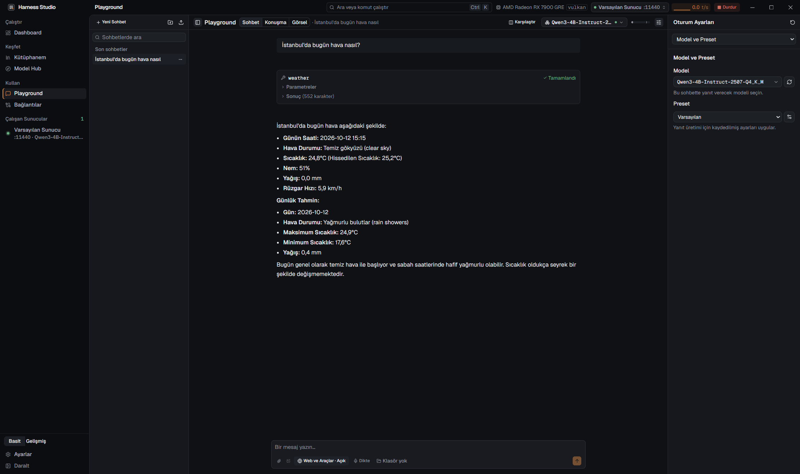
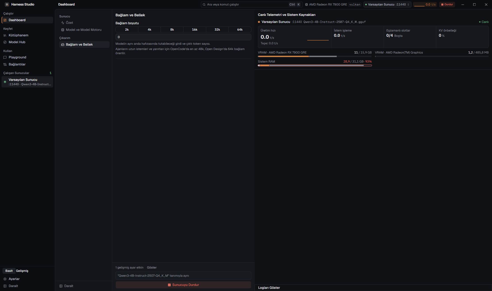

<div align="center">

[English](README.md) | **Türkçe**


# Harness Studio

**Yapay zekâ modellerini kendi bilgisayarınızda çalıştırın. Gizli, ücretsiz ve kolay.**

[](https://github.com/struklabs/harness-studio/releases/latest)
[](https://github.com/struklabs/harness-studio/actions/workflows/ci.yml)
[](LICENSE)
[](https://github.com/struklabs/harness-studio/releases)
[](https://github.com/struklabs/harness-studio/discussions)

[](https://github.com/struklabs/harness-studio/stargazers)

[İndir](https://github.com/struklabs/harness-studio/releases/latest) · [Kullanım kılavuzu](docs/guide/tr/README.md) · [SSS](#sık-sorulan-sorular) · [Yol haritası](docs/tr/ROADMAP.md) · [Projeye destek olun](#projeye-nasıl-destek-olabilirsiniz)

</div>



<p align="center">


</p>

*Ekran görüntüleri Windows uygulamasındandır. Arayüz Türkçe ve İngilizce olarak kullanılabilir.*

## İçindekiler

- [Harness Studio nedir?](#harness-studio-nedir)
- [3 adımda hızlı başlangıç](#3-adımda-hızlı-başlangıç)
- [Sistem gereksinimleri](#sistem-gereksinimleri) ve [Bilgisayarım ne kadar büyük bir modeli çalıştırır?](#bilgisayarım-ne-kadar-büyük-bir-modeli-çalıştırır)
- [Özellikler](#özellikler)
- [Neden Harness Studio? Rakiplerle karşılaştırma](#neden-harness-studio-rakiplerle-karşılaştırma)
- [Gizlilik](#gizlilik)
- [Gelişmiş kullanım (komut satırı ve API)](#gelişmiş-kullanım-komut-satırı-ve-api)
- [Sık sorulan sorular](#sık-sorulan-sorular)
- [Yol haritası](#yol-haritası)
- [Projeye nasıl destek olabilirsiniz?](#projeye-nasıl-destek-olabilirsiniz)
- [Belgeler](#belgeler) · [Kaynaktan derleme](#kaynaktan-derleme) · [Lisans](#lisans)

## Harness Studio nedir?

ChatGPT gibi bir yapay zekâ sohbet programı normalde bir şirketin bilgisayarlarında çalışır: yazdıklarınız internet üzerinden gidip cevap getirir. **Harness Studio yapay zekâyı bunun yerine kendi bilgisayarınızda çalıştırmanızı sağlar.** Bir *model* indirirsiniz (yapay zekânın "beynini" taşıyan bir dosya), bir düğmeye basarsınız ve sohbet edersiniz. İndirmeden sonra hiçbir şeyin bilgisayarınızdan çıkması gerekmez, abonelik yoktur ve internet olmadan da çalışır.

Programcı olmanız gerekmez. Uygulama sizin için model bulur, bilgisayarınıza sığıp sığmadığını denetler, indirir, başlatır ve size bir sohbet penceresi verir. Programcıysanız ya da ileri düzey bir kullanıcıysanız aynı uygulama aynı zamanda OpenAI uyumlu API'si, komut satırı ve araç/MCP desteği olan yerel bir yapay zekâ sunucusudur; editörünüz, kodlama araçlarınız veya betikleriniz yerel modellerinizi kullanabilir.

Harness Studio; Tauri, Rust ve Svelte ile yazılmış bir masaüstü uygulamasıdır. Modelleri gerçekten çalıştıran açık kaynaklı motorları (esas olarak [llama.cpp](https://github.com/ggml-org/llama.cpp)) yönetir ve üzerine kullanışlı bir arayüz, güvenlik denetimleri ve ölçümler ekler.

## 3 adımda hızlı başlangıç

1. **İndirin ve kurun.** [Sürümler sayfasından](https://github.com/struklabs/harness-studio/releases/latest) sisteminize uygun kurulum dosyasını indirin. **Windows:** `Harness.Studio_..._Windows_x64-setup.exe` dosyasını (yaklaşık 21 MB) çalıştırın. Kurulum dosyası **henüz dijital olarak imzalı değildir**; bu yüzden Windows SmartScreen "Windows bilgisayarınızı korudu" diyebilir. **Ek bilgi**'ye, sonra **Yine de çalıştır**'a tıklayın. **macOS:** Mac'inize uygun DMG'yi (Apple Silicon için `Harness.Studio_..._macOS_Apple-Silicon.dmg`, yaklaşık 29 MB; Intel için `Harness.Studio_..._macOS_Intel.dmg`, yaklaşık 32 MB) açın ve **Harness Studio**'yu **Uygulamalar** klasörüne sürükleyin. Uygulama Apple Developer ID ile imzalı ve Apple tarafından doğrulanmıştır (notarization); indirilen her uygulama gibi açılır. Kaynak kod ve derleme akışı bu depoda açıktır.
2. **İlk açılış sihirbazını izleyin.** Donanımınıza bakar, modellerin nerede saklanacağını sorar, modelleri çalıştıran motoru kurar ve gizlilik ayarlarını seçmenizi sağlar. Yeniyseniz **Basit** arayüz düzeyini seçin.
3. **Model seçin ve sohbet edin.** **Model Hub**'da bilgisayarınıza uyan önerilen bir model seçin (uygulama uyum tahmini gösterir) ve **İndir**'e basın. Sonra **Dashboard**'u açın, modeli seçin, **Sunucuyu Başlat**'a basın, **Playground**'u açıp merhaba deyin.

Her ekranın anlatıldığı adım adım rehber: [Kullanım kılavuzu](docs/guide/tr/README.md).

## Sistem gereksinimleri

Bunlar **Harness Studio'nun kendi** gereksinimleridir; herhangi bir modelin değil. Değerler v0.1.0'ın Windows ve macOS (Apple M1, 8 GB) sürümlerinde ölçülmüştür.

| | |
|---|---|
| **İşletim sistemi** | 64 bit Windows 10 veya 11 ya da macOS 13.3 veya üstü: Apple Silicon (Metal hızlandırmalı) veya Intel (yalnızca CPU). Linux (x86_64, `.deb`) *önizleme* aşamasında: şimdilik tek bir Ubuntu makinede test edildi. |
| **Kurulum dosyası boyutu** | Windows'ta yaklaşık 21 MB; macOS'ta DMG yaklaşık 29 MB (Apple Silicon) veya 32 MB (Intel) |
| **Kurulu boyut** | Yaklaşık 65 MB (macOS'ta yaklaşık 64 MB). Bunun üstüne uygulama, gereken model motorlarını ihtiyaç olunca indirir (llama.cpp derlemesi onlarca MB; CUDA derlemeleri daha büyük). |
| **Uygulamanın bellek kullanımı** | Hiçbir model yüklenmeden uygulamanın kendisi (arayüz ve WebView2) yaklaşık 250-350 MB RAM kullanır. macOS'ta yaklaşık 250 MB (arayüz ve WebKit). |
| **WebView2** | Windows 11'de hazır gelir. Windows 10'da eksikse kurulum dosyası otomatik kurar (bunun için bir kez internet gerekir). |
| **macOS** | Disk görüntüsü (DMG): açın ve uygulamayı Uygulamalar klasörüne sürükleyin. Uygulama Developer ID ile imzalı ve Apple tarafından doğrulanmıştır (notarization); mikrofon ve Terminal'i denetleme izinleri güncellemelerde korunur. |
| **Ekran kartı** | **Gerekmez.** İşlemci (CPU) de çalışır. GPU yalnızca modelleri hızlandırır. |
| **Modeller için disk** | Modele göre değişir: küçük bir model için yaklaşık 100 MB, büyük biri için 10 GB ve üstü. Klasörü, başka bir sürücü dahil, siz seçersiniz. |
| **İnternet** | Uygulamayı, motorları ve modelleri indirmek için gerekir. Model diskinizdeyse sohbet için gerekmez. |

Donanımınıza göre otomatik seçilen hızlandırma seçenekleri: **CUDA** (NVIDIA), **ROCm/HIP** (yeni AMD kartlar; Windows'ta HIP SDK kitaplıklarının yüklenebilir olması gerekir, aksi halde Vulkan önerilir), **SYCL** (Intel Arc), **Vulkan** (diğer çoğu GPU), **Metal** (Apple Silicon, macOS sürümüyle) ve **CPU**.

### Bilgisayarım ne kadar büyük bir modeli çalıştırır?

Belirleyici olan *modelin* ne kadar belleğe ihtiyaç duyduğudur; bu da modelin boyutuna ve ne kadar sıkıştırıldığına bağlıdır. Çoğu kişi **GGUF** biçimindeki *nicemlenmiş* (quantized) modelleri indirir: nicemleme (örneğin Q4_K_M) modelin sayılarını daha sıkı biçimde saklar; kalitede küçük bir kayıpla dosya çok küçülür. **VRAM**, ekran kartınızın kendi belleğidir; model tamamen ona sığarsa en hızlı çalışır.

Aşağıdakiler nicemlenmiş GGUF modeller için kaba yol göstericilerdir. Gerçek ihtiyaç, *bağlam* (modelin aynı anda aklında tutabildiği metin miktarı) büyüdükçe de artar.

| Boş bellek (RAM veya GPU'da VRAM) | Rahatça deneyebileceğiniz modeller |
|---|---|
| Yaklaşık 0,5 GB | Minik modeller, 135M-360M parametre. Örneğin **SmolLM2-135M**: yaklaşık 100-150 MB'lık dosya, yaklaşık 500 MB RAM ile çalışır; yani hemen her bilgisayarda çalışır. |
| Yaklaşık 4 GB | Küçük modeller, 1B-3B |
| Yaklaşık 8 GB | Orta boy modeller, 4B-8B |
| 16 GB ve üstü veya 8 GB+ VRAM'li GPU | 12B-14B ve daha büyük modeller |

Bunu kendiniz hesaplamak zorunda değilsiniz. Model Hub ve Dashboard her modelin yanında bir donanım uyumu ipucu gösterir (**VRAM'e sığıyor**, **VRAM sınırda**, **Kısmi GPU aktarımı**, **Çoğunlukla CPU**, **Bellek yetmeyebilir**). **Bağlam boyutu** ve **GPU katmanları** **Otomatik**'te bırakıldığında Harness Studio güvenli ayarları sizin için seçer: küçük bir ekran kartında tüm katmanları GPU'da tutup bağlamı küçültmeyi tercih eder; sığmayacak bir isteği çok yavaş çalıştırmak yerine yüklemeyi reddeder. Yine de sığmazsa bir pencere neyin yetmediğini ve neyi değiştirmeniz gerektiğini anlatır.

## Özellikler

- **audio.cpp ile deneysel metinden konuşma:** PocketTTS ve diğer audio.cpp TTS GGUF aileleri Playground ve `/v1/audio/speech` üzerinden çalışır. Motor varsayılan olarak kapalıdır; risk bildirimini onaylayıp **Ayarlar > Model Motoru > Kurulu Model Motoru > Diğer Model Motorları** altında etkinleştirin. Platforma göre Vulkan, CUDA, Metal veya CPU kullanılır. Ses gömmeleri konuşma seçicisinde görünür; işçiler beş dakika boş kalınca durur.

Aşağıdakilerin hepsi yerel çalışır. Ayrıntılar [kullanım kılavuzunda](docs/guide/tr/README.md) ve [FEATURES.md](docs/tr/FEATURES.md) içindedir.

### Günlük kullanıcılar için

- **Model Hub:** Hugging Face'te filtreli arama, model kartları, modelin donanımınıza uyup uymadığı ve SHA-256 sağlama toplamı doğrulayan, devam ettirilebilir indirme kuyruğu.
- **Playground:** kayıtlı konuşmalar, yan yana model karşılaştırma, Markdown ve Mermaid şemaları, görsel girdisi (vision modelleri), yerel arama ve kaynak göstermeli belge sohbeti (RAG), konuşmadan yazıya, sesli okuma ve görsel üretimi olan bir sohbet penceresi.
- **Sohbette araçlar:** modeller yerleşik dosya, web ve hava durumu araçlarını kullanabilir; riskli bir şey çalışmadan önce onayınız istenir.
- **Basit ve Gelişmiş düzeyler:** Basit düzey ilk kez kullanan biri için gereken her şeyi gösterir; Gelişmiş düzey tüm ayarları açar. Düzey değiştirmek hiçbir ayarı kaybettirmez ([ayrıntılar](docs/tr/UI_LEVELS.md)).
- **Rahat kullanım:** Türkçe ve İngilizce arayüz, açık ve koyu temalar, yüksek karşıtlık ve renk körlüğüne uygun seçenekler, sistem tepsisi ve oturum açılınca başlatma.

### Geliştiriciler ve araç kullanıcıları için

- **Birçok model için tek yerel adres** (*ağ geçidi*): OpenAI, Anthropic ve Ollama API'lerini konuşur. Modeller ilk istekte yüklenir, boşta kalınca boşaltılır. İsteğe bağlıdır.
- **Araçlarınız için yönlendirmeli kurulum:** Claude Code, Codex, OpenCode, Aider, Goose, Continue, Zed, VS Code, Cline, JetBrains, Open WebUI ve daha fazlası; fark önizlemesi, yedek ve tek tıkla geri alma ile. `harness launch` bir aracı doğru ayarlarla başlatır ve genel ayarlarınıza dokunmaz.
- **Yerel modellerde çalışan araç çağırma:** metin biçimindeki araç çağrıları gerçek OpenAI tarzı `tool_calls`'a çevrilir; kodlama araçları kullanılabilir sonuç alır ([ölçümler](docs/tr/COMPARISON.md)).
- **Her iki yönde MCP:** MCP sunucularını sohbetlerinize bağlayın; diğer araçlar da Harness'in kendisini MCP sunucusu olarak kullanabilsin.
- **Özel araçlar:** bir aracı anlatın, yerel bir model onu korumalı (sandbox) JavaScript olarak üretsin.

### Gelişmiş kullanım (komut satırı ve API)

- **Aynı anda birden çok sunucu:** profiller, otomatik portlar, bellek tahminleri, canlı telemetri ve açık hata yönlendirmesi (bellek yetmezliği, eksik kütüphane, port çakışması).
- **llama.cpp üzerinde tam denetim:** bağlam, GPU katmanları, KV önbellek türü, slot sayısı, örnekleme ve daha fazlası; ayrıca SHA-256 doğrulamalı motorlardan oluşan bir çalışma zamanı kaydı ve sunucu başına motor seçimi. [CLI başvurusuna](docs/tr/CLI.md) bakın.
- **Gözlemlenebilirlik:** karşılaştırmalı testler (benchmark), istek analitiği (P50/P95 gecikme, token, hata, istemci bazında), araç çağrısı teşhisi, aranabilir günlükler, Prometheus `/metrics` ve isteğe bağlı OpenTelemetry dışa aktarımı.
- **CLI, Control API ve başsız kip:** `harness` komutu, OpenAPI şemalı yetkilendirmeli Control API ve pencere olmadan çalıştıran `harness serve`. Hepsi uygulamayla aynı Rust kodunu kullanır.
- **Daha fazla motor:** whisper.cpp, sherpa-onnx, ONNX Runtime, CrispASR, deneysel audio.cpp (varsayılan olarak kapalı), stable-diffusion.cpp, Python (`python-hf`, CPU/CUDA; transformers ve diffusers), MLX (sohbet, görüntü, ses; Apple Silicon, macOS 14+), Lemonade ve mistral.rs. Safetensors modelleri Hub üzerinden GGUF biçimine dönüştürülebilir.

## Neden Harness Studio? Rakiplerle karşılaştırma

Zaten iyi araçlar var ve Harness Studio herkes için hepsinin yerini almaz. Amacı, [LM Studio](https://lmstudio.ai) ve [Ollama](https://ollama.com)'nın yaptığını **llama.cpp'nin gelişmiş ayarlarını saklamadan** yapmak; gözlemlenebilirlikte ve kodlama araçlarıyla çalışmada daha güçlü olmak ve tamamen açık kaynak kalmaktır.

### LM Studio, Ollama ve llama.cpp ile ölçülmüş karşılaştırma

Tek bir Windows bilgisayarda (AMD RX 7900 GRE 16 GB, Vulkan) aynı GGUF dosyaları, her araç kendi varsayılanlarında:

| Kutudan çıktığı gibi | Harness Studio | LM Studio | Ollama | llama.cpp |
|---|---|---|---|---|
| Qwen3-4B üretim hızı (tok/s) | 140,9 | 142,0 | 128,9 | 114,5 |
| Qwen2.5-Coder-14B üretim hızı (tok/s) | 48,6 | 42,0 | 49,0 | 40,9 |
| 4 eşzamanlı istek, toplam (tok/s) | **344** | 157 | 126 | 152 |
| 14B araç çağırma (38 durum) | **36/38** | 5/38 | 4/38 | 5/38 |
| 20 bin token'lık istem | doğru | bağlam hatası | bağlam hatası | doğru |
| 14B, 65 bin bağlamda paylaşımlı belleğe taşma | **98 MiB** | 12,4 GB | 10,3 GB | 5,2 GB |
| Tek adresten model değiştirme | 6,5 sn | yanlış model yanıtladı | 5,6 sn | yeniden başlatma gerekir |

Diğerleri bazı satırlarda öndedir: Ollama uzun istemleri daha hızlı işledi; 65 bin bağlamda LM Studio ve Ollama paylaşımlı belleğe taşarak yaklaşık 3 kat hızlı üretti, Harness ise modeli ekran kartı belleğinde tutar. Yöntem, sınırlar ve tüm tablolar: [COMPARISON.md](docs/tr/COMPARISON.md).

### Özellik karşılaştırması

✓ var · ✗ yok · kısmi = sınırlı. Kaynak: [FEATURES.md](docs/tr/FEATURES.md) içindeki denetlenmiş tablo; rakip sütunları orada yazan sürümleri yansıtır.

| Özellik | Harness Studio | LM Studio | Ollama | llama.cpp (`llama-server`) |
|---|---|---|---|---|
| Kullanışlı masaüstü uygulaması | ✓ | ✓ | ✓ | ✗ (basit web sayfalı sunucu) |
| Windows / Linux / macOS | Windows ve macOS; Linux önizleme | ✓ | ✓ | ✓ |
| Apple MLX motoru | ✓ (isteğe bağlı, Apple Silicon, macOS 14+) | ✓ | ✓ | ✗ |
| Yerleşik istek analitiği (P50/P95, istemci bazında) | ✓ | ✗ | ✗ | ✗ |
| Prometheus metrikleri ve OpenTelemetry | ✓ | ✗ | ✗ | kısmi (metrik uç noktası) |
| Diğer araçlar için MCP sunucusu olarak çalışma | ✓ | ✗ | ✗ | ✗ |
| Kodlama araçlarını tek komutla başlatma | ✓ | ✗ | ✓ | ✗ |
| Kapsamlı (scope) adlandırılmış erişim token'ları | ✓ | ✓ | ✗ | ✗ |
| Yönetim API'si için OpenAPI şeması | ✓ | ✗ | ✓ | ✗ |
| Yüksek karşıtlık ve renk körlüğüne uygun temalar | ✓ | ✗ | ✗ | — |
| Arayüz dilleri | kısmi (Türkçe, İngilizce) | ✓ (30+) | doğrulanmadı | — |
| Resmî JS ve Python SDK'ları | kısmen (depoda; henüz npm/PyPI'da yok) | ✓ | ✓ | ✗ |

### Diğer araçlarla ilişkisi

| Araç | Nedir | Harness Studio ile ilişkisi |
|---|---|---|
| **Jan** | Yerel ve bulut modeller için masaüstü sohbet uygulaması | Jan'ın Harness adresini kullanması için adım adım kurulum rehberi var. Harness sunucu yönetimi ve gözlemlenebilirlik ekler. |
| **GPT4All** | Modelleri yerelde çalıştıran masaüstü sohbet uygulaması | Benzer günlük kullanım; Harness OpenAI/Anthropic/Ollama uyumlu ağ geçidi, CLI ve araç desteği ekler. |
| **AnythingLLM** | Belgelerinizle sohbet için çalışma alanı uygulaması | Harness'te yerleşik yerel belge sohbeti (RAG) vardır ve OpenAI uyumlu her uygulama Harness adresini kullanabilir. |
| **LocalAI** | Kendi sunucunuzda çalışan, OpenAI uyumlu API sunucusu | LocalAI önce sunucudur. Harness bugün önce masaüstüdür; web arayüzlü bir **sunucu kipi** planlıdır. |
| **Open WebUI** | Ollama ve OpenAI tarzı API'ler için web sohbet arayüzü | Harness adresiyle çalışır (yönlendirmeli kurulum var). Harness'in kendi masaüstü arayüzü de var. |
| **llama-swap / yalın llama.cpp** | Model değiştiren bir ara sunucu ve motorun kendisi | Harness llama.cpp'yi sizin için yönetir; model değiştirme, güvenli varsayılanlar ve aynı ham ayarlar dahil. |

### Ne farklı?

- **Çalışan varsayılanlar.** Eşit ayarlarla bu araçların hepsi yaklaşık aynı hızda çalışır, çünkü llama.cpp çekirdeğini paylaşırlar. Fark, her aracın sizin yerinize ne seçtiğinden gelir. Harness bağlamı ve GPU aktarımını boş VRAM'inize ve modele göre ayarlar; böylece 20 bin token'lık bir istem ayar yapmadan çalışır.
- **Sessiz yavaşlama yok.** Modelleri paylaşımlı sistem belleğinin dışında tutar, sığmayan istekleri nedenini açıklayarak reddeder.
- **İstemcilerin kullanabildiği araç çağrıları.** Metin biçimindeki araç çağrılarını varsayılan olarak gerçeğine çevirir.
- **Birden çok model ve kullanıcı için tasarlandı.** Eşzamanlılık, tek adresten model değiştirme, token başına sınırlar ve istemci bazında analitik.
- **Gözlemlenebilirlik yerleşik.** İstek analitiği, izleme görünümü, Prometheus ve OpenTelemetry.
- **Tek çekirdek, çok kapı.** Uygulama, CLI, Control API ve MCP aynı Rust servislerini kullanır.
- **Dürüst sınırlar.** Harness Studio küçük bir ekibin ilk herkese açık sürümüdür (0.1.0). LM Studio ve Ollama'nın daha büyük kullanıcı kitleleri, model kataloğu, macOS desteği ve SDK'ları var. Bkz. [Rakiplerin önde olduğu yerler](docs/tr/COMPARISON.md).

## Gizlilik

- **Sohbetleriniz bilgisayarınızda kalır.** Modeller yerelde çalışır. Sohbet geçmişi, uygulamanın veri klasöründe diskinizde saklanır.
- **Kullanım takibi yok.** Uygulama telemetri ve otomatik çökme raporu göndermez. Tanılama raporları yalnızca cihazınızda saklanır, içeriğini siz seçersiniz ve istemleri, yanıtları ya da dosya içeriklerini asla içermez.
- **Uygulama internete ne zaman çıkar:** Hugging Face'te model aramak ve indirmek, motor ve güncelleme indirmek, eklediğiniz bir bağlantıyı almak ve *siz* web araması ya da hava durumu gibi web araçlarını açtığınızda. OpenTelemetry dışa aktarımı, siz etkinleştirip kendi toplayıcı adresinizi girmedikçe kapalıdır.
- **Yerel adres yereldir.** Ağ geçidi ve API'ler siz ağ erişimini açmadıkça yalnızca kendi bilgisayarınızda dinler; açtığınızda token ister. [Güvenlik modeline](docs/tr/SECURITY_MODEL.md) bakın.
- **İstek günlüğü içeriği değil, üst veriyi saklar.** İstek analitiği süre ve token sayısı gibi bilgileri tutar. İstem ve yanıtları kaydetme varsayılan olarak kapalıdır, model tanımı başına isteğe bağlıdır ve süre sınırı vardır.

## Gelişmiş kullanım (komut satırı ve API)

Bir terminalde ağ geçidiyle başsız bir sahip başlatın, diğerinden kullanın:

```sh
harness serve --gateway                  # arayüzsüz çalıştır; ağ geçidi 127.0.0.1:11435'te
harness search Qwen3                     # Hugging Face'te ara
harness pull unsloth/Qwen3-4B-Instruct-2507-GGUF:Q4_K_M
harness load Qwen3-4B-Instruct-2507-Q4_K_M
harness run Qwen3-4B-Instruct-2507-Q4_K_M "Merhaba de."
harness ps --json                        # yüklü modeller, makine okunabilir
```

OpenAI uyumlu her istemci yerel modelinizi kullanabilir:

```sh
curl http://127.0.0.1:11435/v1/chat/completions \
  -H "Content-Type: application/json" \
  -d '{"model":"Qwen3-4B-Instruct-2507-Q4_K_M","messages":[{"role":"user","content":"Merhaba de."}]}'
```

```python
from openai import OpenAI

client = OpenAI(base_url="http://127.0.0.1:11435/v1", api_key="not-needed")
reply = client.chat.completions.create(
    model="Qwen3-4B-Instruct-2507-Q4_K_M",
    messages=[{"role": "user", "content": "Merhaba de."}],
)
print(reply.choices[0].message.content)
```

Anthropic tarzı (`/v1/messages`) ve Ollama tarzı (`/api/chat`) istemciler aynı ağ geçidinde çalışır. `harness mcp` Harness'i stdio üzerinden MCP sunucusu olarak sunar. Çalışan bir sahip olmadan tek seferlik kullanım: `harness --headless run ./model.gguf "2+2?" --json`.

Başvuru: [CLI.md](docs/tr/CLI.md) · [MCP.md](docs/tr/MCP.md) · [INTEGRATIONS.md](docs/tr/INTEGRATIONS.md) · [ARCHITECTURE.md](docs/tr/ARCHITECTURE.md) · [PERFORMANCE.md](docs/tr/PERFORMANCE.md)

## Sık sorulan sorular

<details>
<summary><b>Harness Studio ücretsiz mi?</b></summary>

Evet. Uygulama MIT Lisansı ile açık kaynaktır; abonelik, hesap ya da reklam yoktur. İndirdiğiniz modellerin kendi lisansları vardır (aşağıdaki ticari kullanım sorusuna bakın).
</details>

<details>
<summary><b>İnternetsiz çalışır mı? Sohbetlerim bilgisayarımdan çıkıyor mu?</b></summary>

Uygulama, bir motor ve bir model diskinizdeyse sohbet internetsiz çalışır ve konuşmalarınız bilgisayarınızda kalır. Uygulama yalnızca siz istediğinizde internete çıkar (model arama ve indirme, motor ve uygulama güncellemeleri, açtığınız web araçları). Bkz. [Gizlilik](#gizlilik).
</details>

<details>
<summary><b>GPU'ya veya güçlü bir bilgisayara ihtiyacım var mı?</b></summary>

Hayır. İşlemci de çalışır; GPU yalnızca modelleri hızlandırır. Küçük modeller mütevazı makinelerde çalışır; bkz. [Bilgisayarım ne kadar büyük bir modeli çalıştırır?](#bilgisayarım-ne-kadar-büyük-bir-modeli-çalıştırır). Uygulamanın kendisi yaklaşık 250-350 MB RAM kullanır.
</details>

<details>
<summary><b>Hangi modelleri çalıştırabilirim, nereden bulurum?</b></summary>

Esas olarak llama.cpp için GGUF modeller: sohbet, kodlama, görsel (vision), embedding ve rerank modelleri. **Model Hub** sizin için Hugging Face'te arar, boyutu ve donanım uyumunu gösterir, sağlama toplamı doğrulayarak indirir. Konuşma (Whisper, sherpa-onnx ve ONNX CTC), görsel üretimi (Stable Diffusion ve FLUX paketleri) ve ONNX modelleri, uygulamanın kurmayı önerdiği isteğe bağlı motorları gerektirir. Safetensors modelleri uygulama içinde GGUF'a dönüştürülebilir.
</details>

<details>
<summary><b>Elimdeki GGUF dosyalarını veya Ollama / LM Studio modellerimi kullanabilir miyim?</b></summary>

Evet. GGUF dosyalarınızın bulunduğu klasörleri **Ayarlar > Depolama > Dizinler** altından ekleyin ya da Kütüphane'den Ollama ve LM Studio'dan içe aktarın. Bkz. [Model Hub ve Kütüphane kılavuzu](docs/guide/tr/02-model-hub-ve-kutuphane.md).
</details>

<details>
<summary><b>Editörüm veya kodlama aracım kullanabilir mi? OpenAI uyumlu API var mı?</b></summary>

Evet. Ağ geçidini açtığınızda OpenAI, Anthropic ve Ollama API'leriyle uyumlu tek bir yerel adres elde edersiniz. **Bağlantılar** sayfası Claude Code, Codex, OpenCode, Aider, Goose, Continue, Zed, VS Code, Cline, JetBrains, Open WebUI ve diğerleri için önizleme ve geri alma ile yönlendirmeli kurulum sunar. Bkz. [INTEGRATIONS.md](docs/tr/INTEGRATIONS.md).
</details>

<details>
<summary><b>Ollama ve LM Studio'dan farkı ne?</b></summary>

Üçü de llama.cpp üzerinde modelleri yerelde çalıştırır. Harness Studio gelişmiş ayarları görünür tutar, tamamen açık kaynaktır, araç çağırmayı ve uzun bağlamları kutudan çıktığı gibi çalıştırır; yerleşik analitiği, izleme görünümü, MCP sunucusu ve CLI'ı vardır. LM Studio ve Ollama daha olgundur ve daha çok platformda bulunur. Bkz. [Neden Harness Studio?](#neden-harness-studio-rakiplerle-karşılaştırma).
</details>

<details>
<summary><b>Windows SmartScreen uyarı veriyor. Güvenli mi?</b></summary>

v0.1.0 kurulum dosyası henüz dijital olarak imzalı değil; SmartScreen bilinmeyen yayıncılar için uyarır. **Ek bilgi**'yi, sonra **Yine de çalıştır**'ı seçin. Kaynak kod ve derleme akışı bu depoda herkese açıktır; imzalı kurulum dosyası [yol haritasında](#yol-haritası).
</details>

<details>
<summary><b>Güncellemeler nasıl çalışır?</b></summary>

**Ayarlar > Güncellemeler** yeni sürümü denetleyip kurabilir. Güncelleme kaynağı yoksa en yeni kurulum dosyasını [Sürümler](https://github.com/struklabs/harness-studio/releases) sayfasından indirip çalıştırın. llama.cpp motoru ayrıca **Ayarlar > Model Motoru** altında güncellenir; orada eski sürüme de dönebilirsiniz.
</details>

<details>
<summary><b>Nasıl kaldırırım, dosyalarım nerede?</b></summary>

Windows'ta **Uygulamalar > Yüklü uygulamalar**'ı kullanın. Kaldırma, kaldırıcıda **Uygulama verilerini sil** işaretlenmedikçe verilerinizi korur; bu seçenek uygulamanın veri klasörlerini (`%APPDATA%\com.harnessstudio.app` ve `%LOCALAPPDATA%\com.harnessstudio.app`: ayarlar, sohbetler, motorlar, günlükler ve burada duran modeller) siler. Başka bir yerde seçtiğiniz model klasöründeki (**Ayarlar > Depolama > Dizinler**) modeller her iki durumda da kalır. Tam kaldırma için CLI oturum servisini kurduysanız önce `harness service uninstall` çalıştırın, saklanan kimlik bilgilerini (Hugging Face belirteci, sunucu API anahtarları) uygulamadan veya Windows Kimlik Bilgileri Yöneticisi'nden (`com.harnessstudio.app` içeren girdiler) temizleyin. Ardından uygulamayı kaldırın ve istemediğiniz veri ve model klasörlerini silin. Önce ihtiyacınız olanları yedekleyin.
</details>

<details>
<summary><b>Linux veya macOS'ta çalışır mı?</b></summary>

macOS: evet. Apple Silicon (Metal hızlandırmalı) ve Intel Mac'ler (yalnızca CPU) için birer DMG var; macOS 13.3 veya üstü gerekir. İlk açılış adımı için bkz. [Hızlı başlangıç](#3-adımda-hızlı-başlangıç). Linux: Releases sayfasında **önizleme** olarak bir `.deb` paketi (x86_64) var; AppImage 0.1.1 ile gelecek. Şimdilik tek bir Ubuntu makinede test edildi; pürüzler olabilir, bulduklarınızı lütfen bildirin. Linux'un daha geniş testi [yol haritasındadır](#yol-haritası).
</details>

<details>
<summary><b>Sunucuda çalıştırabilir miyim?</b></summary>

`harness serve` pencere olmadan çalışır, ağ geçidini ve Control API'yi sunar; uzak örnekler `HARNESS_HOST` ve `HARNESS_TOKEN` ile kullanılabilir. Web arayüzlü, otomatik HTTPS'li ve Docker imajlı tam bir **sunucu kipi** planlıdır; henüz yoktur.
</details>

<details>
<summary><b>Ticari olarak kullanabilir miyim?</b></summary>

Uygulama MIT lisanslıdır, ticari kullanabilirsiniz. **Her modelin kendi lisansı vardır** (bazıları ticari kullanımı yasaklar ya da sınırlar). Model Hub modelin lisansını gösterir; bir üründe kullanmadan önce kontrol edin.
</details>

<details>
<summary><b>Verilerim veya kullanımım izleniyor mu?</b></summary>

Hayır. Telemetri ve hesap yoktur. Bkz. [Gizlilik](#gizlilik).
</details>

<details>
<summary><b>Telefonumdan veya başka bir bilgisayardan nasıl kullanırım?</b></summary>

**Ayarlar > Ağ Geçidi** altında **Ağdan erişime izin ver**'i açın ve `inference` kapsamlı adlandırılmış bir token oluşturun. Token'sız ağ erişimine izin verilmez. Güvenlik duvarınızı kendiniz ayarlamalısınız. Başka bir Harness örneğinin modellerini kullanmak için yerleşik bir yol (**Harness Link**) planlıdır.
</details>

<details>
<summary><b>Model yüklenmiyor ya da yavaş. Ne yapmalıyım?</b></summary>

Bellek yetmezse bir pencere neyin sığmadığını gösterir ve çözümler sunar (daha kısa bağlam, daha az GPU katmanı, daha küçük nicemleme). Bkz. [sorun giderme kılavuzu](docs/guide/tr/10-sorun-giderme.md).
</details>

<details>
<summary><b>Hata nasıl bildiririm, özellik nasıl isterim?</b></summary>

İşletim sisteminiz, GPU ve sürücünüz, arka uç, uygulama sürümü, kullandığınız model ve hata metniyle bir [issue](https://github.com/struklabs/harness-studio/issues/new/choose) açın (tanılama raporları kişisel bilgiler çıkarılarak dışa aktarılabilir). Sorular ve fikirler [Discussions](https://github.com/struklabs/harness-studio/discussions) sayfasına. Güvenlik sorunları: [SECURITY.md](SECURITY.md).
</details>

## Yol haritası

Güncel ve tam liste [ROADMAP.md](docs/tr/ROADMAP.md) içindedir. Söz değil, yön gösterir.

**Şimdi mevcut (v0.1.0)**
- Windows kurulum dosyası; Model Hub, Kütüphane, Dashboard, Playground
- OpenAI, Anthropic ve Ollama API'li ağ geçidi; yönlendirmeli araç entegrasyonları
- Araçlar ve MCP; CLI, Control API ve başsız kip
- Analitik, karşılaştırmalı testler ve Prometheus/OpenTelemetry dışa aktarımı
- Konuşma, görsel üretimi, embedding ve rerank motorları

**Üzerinde çalışılıyor**
- Linux derlemelerinin daha çok donanımda (AMD, NVIDIA, Intel) ve dağıtımda doğrulanması
- Her platformda ilk açılış deneyiminin cilalanması
- Linux'ta karşılaştırmalı testler (Windows'ta NVIDIA/CUDA tamamlandı)
- Küçük pencere ve yüksek arayüz ölçeği için erişilebilirlik denetimleri

**Sıradaki planlar**
- **Sunucu kipi:** Harness'i kendi sunucunuzda web arayüzünden yönetin; parola ya da token oturumları, alan adı ve otomatik SSL, systemd servisi ve Docker imajları (CUDA, ROCm, Vulkan, CPU)
- **Harness Link:** başka bir Harness örneğinin modellerini kütüphanenizde, Playground'da ve ağ geçidinde kullanın
- Önizlemenin ötesinde imzalı Linux paketleri
- Kod imzalı Windows kurulum dosyası; arka planda katılımsız uygulama güncellemesi
- Control API SDK'larının npm ve PyPI'da yayımlanması; karar modeli uç noktaları

**Daha sonra:** araçlar ve MCP sunucuları için topluluk kayıt defteri, ComfyUI köprüsü, araç yönlendirici ve daha çok üretim sayfası.

## Projeye nasıl destek olabilirsiniz?

Harness Studio açıkta geliştirilir ve her yardım değerlidir.

- **Depoya yıldız verin** ve özel, yerel yapay zekâ isteyebilecek biriyle **paylaşın**.
- [Issues](https://github.com/struklabs/harness-studio/issues) ve [Discussions](https://github.com/struklabs/harness-studio/discussions) üzerinden **hata bildirin** ve **özellik önerin**.
- **Çevirileri ve belgeleri geliştirin.** Türkçe ve İngilizce eşit önemdedir.
- Pull request ile **kod katkısı verin.** Bakımcılar her değişikliği inceler; önce [CONTRIBUTING.md](CONTRIBUTING.md) dosyasını okuyun.
- **Kendi donanımınızda test edin** ve ölçümlerinizi paylaşın; özellikle NVIDIA, Intel, Linux ve macOS. Çalıştırıcı [`bench/compare/`](bench/compare/) içindedir.
- **Projeye sponsor olun** ya da iş birliği görüşün: **ugur.enes.ustundag@gmail.com**.

## Belgeler

| Belge | Ne anlatır |
|---|---|
| [Kullanım kılavuzu (Türkçe)](docs/guide/tr/README.md) | Kurulum, Model Hub, Dashboard, Playground, bağlantılar, araçlar, ayarlar, CLI, sorun giderme |
| [User guide (English)](docs/guide/en/README.md) | Aynı kılavuzun İngilizcesi |
| [CLI](docs/tr/CLI.md) | Komutlar, servisler, JSON çıktısı, çıkış kodları |
| [Entegrasyonlar](docs/tr/INTEGRATIONS.md) | Kodlama araçları: başlatma ve yapılandırma biçimleri, geri alma |
| [MCP](docs/tr/MCP.md) · [Araçlar](docs/tr/TOOLS.md) | MCP sunucusu ve istemcisi olarak Harness; yerleşik ve özel araçlar |
| [Performans](docs/tr/PERFORMANCE.md) · [Karşılaştırma](docs/tr/COMPARISON.md) | Ölçümler ve yöntem |
| [Mimari](docs/tr/ARCHITECTURE.md) · [Güvenlik modeli](docs/tr/SECURITY_MODEL.md) | Servisler, ağ geçidi, güven sınırları |
| [Özellikler](docs/tr/FEATURES.md) · [Arayüz düzeyleri](docs/tr/UI_LEVELS.md) | Özellik özellik tablo; Basit ve Gelişmiş düzeyler |
| [Yol haritası](docs/tr/ROADMAP.md) · [Değişiklik günlüğü](docs/CHANGELOG.md) | Açık işler; her sürümde neler değişti |

## Kaynaktan derleme

**Rust (stable)**, **Node.js 22+** ve işletim sisteminiz için [Tauri ön koşulları](https://v2.tauri.app/start/prerequisites/) gerekir.

```sh
npm ci
npm run tauri dev      # uygulamayı geliştirme kipinde çalıştır
npm run tauri build    # kurulum dosyasını derle (Windows'ta NSIS ve MSI; sürümler NSIS kullanır, kaldırmada CLI PATH temizliği yalnız NSIS'te vardır)
```

Derleme `harness` CLI'ını ve yardımcı programları da derler. Yalnızca CLI: `cargo build -p harness-cli --release`. Geliştirme denetimleri ve kurallar: [CONTRIBUTING.md](CONTRIBUTING.md).

## Topluluk

Lütfen [Davranış Kuralları](CODE_OF_CONDUCT.md)'nı okuyun. Sorular: [Discussions](https://github.com/struklabs/harness-studio/discussions). Hata ve istekler: [Issues](https://github.com/struklabs/harness-studio/issues). Yardım seçenekleri: [SUPPORT.md](SUPPORT.md). Güvenlik açığı mı buldunuz? Herkese açık issue yerine [SECURITY.md](SECURITY.md) adımlarını izleyin.

## Lisans

Harness Studio [MIT Lisansı](LICENSE) ile yayımlanır. Telif hakkı (c) 2026 struklabs ve Harness Studio katkıda bulunanları.

### Teşekkürler

- [audio.cpp](https://github.com/0xShug0/audio.cpp) — yerel ses çıkarım motoru, [Apache-2.0](https://github.com/0xShug0/audio.cpp/blob/main/LICENSE). Model lisansları motor lisansından ayrıdır.

Harness Studio harika açık kaynak projelerin omuzlarında durur:

- [llama.cpp](https://github.com/ggml-org/llama.cpp) (MIT), varsayılan çıkarım motoru
- [whisper.cpp](https://github.com/ggml-org/whisper.cpp) (MIT), konuşmadan yazıya
- [stable-diffusion.cpp](https://github.com/leejet/stable-diffusion.cpp) (MIT), görsel üretimi
- [sherpa-onnx](https://github.com/k2-fsa/sherpa-onnx) (Apache-2.0), konuşma tanıma, ses etkinliği algılama ve metinden sese
- [ONNX Runtime](https://github.com/microsoft/onnxruntime) (MIT), embedding ve rerank
- [Lemonade](https://github.com/lemonade-sdk/lemonade) (Apache-2.0) ve [mistral.rs](https://github.com/EricLBuehler/mistral.rs) (MIT), isteğe bağlı motorlar
- [Tauri](https://tauri.app) (MIT veya Apache-2.0) ve [Svelte](https://svelte.dev) (MIT), uygulama çatısı ve arayüz
- [QuickJS](https://bellard.org/quickjs/) (MIT), özel araçlar için korumalı alan

Tüm lisans koşulları için her projeye bakın. İndirdiğiniz model dosyalarının kendi lisansları vardır ve Model Hub'da gösterilir.

**Harness Studio, struklabs'ın açık kaynak bir projesidir.**
