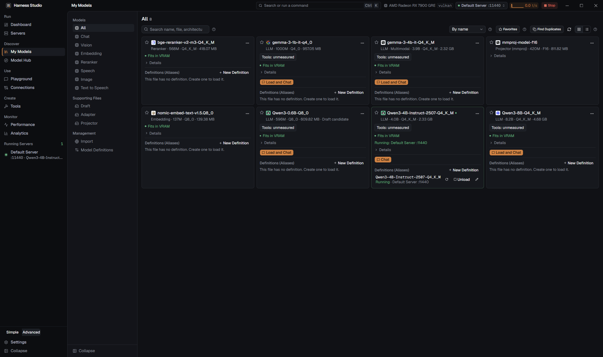
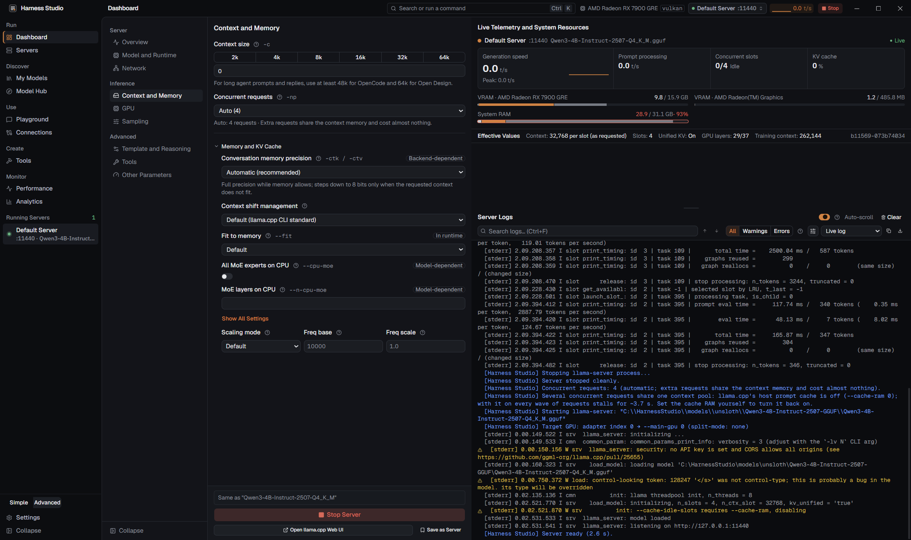
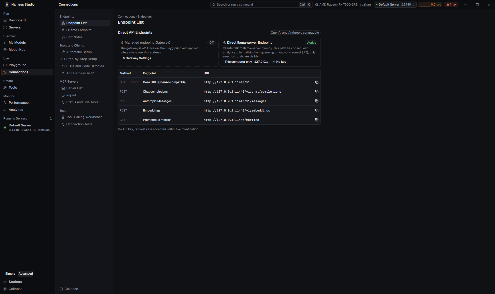
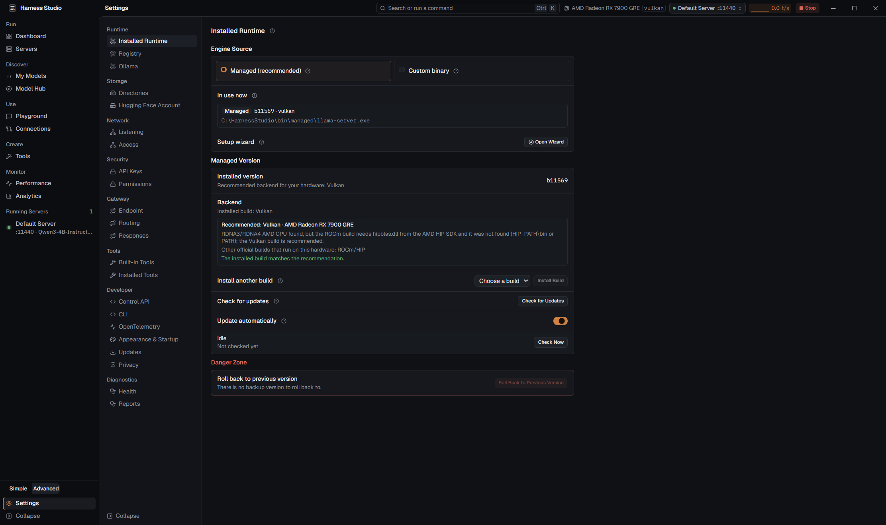

Türkçe: ../tr/UI_LEVELS.md

# Interface level (Simple / Advanced) and information hierarchy

## 1. Background

- **A wide feature surface with no layers.** There are 10 main screens; the Dashboard alone has 9 sub-pages, Settings 22, and My Models 11. A user who only wants to pick a model and chat meets `-np`, `--fit`, `--cpu-moe`, KV cache quantization, router mode, runtime selection, the gateway endpoint table, and MCP servers at the same level as everything else.
- **Text and controls carry the same visual weight.** The Dashboard `Field` label is 12 px `font-medium` and the description below it is 12 px `muted-foreground`: the only difference is weight and tone. The `SettingRow` description is always inline. 52 `SettingRow` and 13 `Field` rows carry inline descriptions, and components also contain 233 hand-written `text-xs text-muted-foreground` paragraphs (most in Connections, Tools, Analytics, and Settings > Gateway).
- **Technical metadata in the accent color.** The "Tied to the backend", "Tied to the model", and "Present in the runtime" badges had a copper (primary) border. That breaks the design system's "single accent color" rule and pulls the eye away from the actual control. Flag names (`-c`, `--fit`) appeared next to every label.
- **The infrastructure was ready.** Field help is shared (`InfoTip`, `HelpPopover`, `FieldHelp`, `describeFields`), the page hierarchy is declarative (`screenSections.ts`, `settings/sections.ts`, the `Sidebar.svelte` groups), and settings live in one file (`AppSettings`, with serde defaults). So a single visibility layer is possible instead of two separate interfaces.

## 2. Decision

Two separate views were rejected in favor of **one interface with two information levels** (progressive disclosure):

- No separate screen trees. Every screen is a single component. Only some pages, sections, and fields are marked **Advanced**.
- The level changes **visibility only**. It never changes, resets, or saves any value. A hidden setting is still applied at the Simple level. Switching therefore never loses a setting, and the two levels cannot become inconsistent.
- Text density is not a separate mode. It is resolved by the same layer rules **at both levels** (section 4).

Why not two separate views: maintenance would double. Every new feature would be written in two places and behavior would drift apart. Switching the level would feel like switching to a different application. With progressive disclosure each item stays where it is, and the Advanced level only shows more.

## 3. Interface level

### Rules

1. **Single source of truth:** `AppSettings.ui_level` (`"simple"` | `"advanced"`, or `null` when unset). `null` = **Advanced**, so existing users lose nothing after an update. On a new install the setup wizard asks; the recommended choice is **Simple**.
2. **Hidden pages are never dead ends.** The command palette, deep links (`#settings/...`), "Settings > X" links in error messages, and cross-screen links open Advanced pages even at the Simple level. A thin banner then appears at the top of the page: "This page is at the Advanced level · Switch to Advanced Level". The page works normally.
3. **Active hidden settings are reported.** If a parameter hidden at the Simple level differs from its default (for example the KV cache type on the Dashboard), a single line appears in the relevant place: "2 advanced settings active · Show". The user can find out why behavior differs.
4. **One-click switch:** a level switch below the main navigation (above Settings), an "Interface level" row in Settings > Appearance & Startup, and "Switch to Advanced Level" / "Switch to Simple Level" in the command palette. The switch applies immediately and is saved immediately (like theme and language).
5. **Declarative marking:** the level is stored next to the data.
   - Pages and navigation items: `SectionPage.level`, `Sidebar` `NavItem.level`, Settings sub-pages `level`.
   - Sections and fields: the `<AdvancedOnly>` wrapper, and an `advanced` prop on `SettingRow` / `SwitchRow` / `SettingGroup` / `Field`.
   - Default: an unmarked item is visible at both levels. When adding a feature there is a single decision: "Does someone using local AI for the first time need this?" If not, mark it `advanced`.
6. **Switching the level does not change navigation.** If the user switches to Simple while on an Advanced page, they stay on that page and the banner from rule 2 appears at the top. When they navigate to another page, hidden pages no longer appear in the list. The saved "last page" preference is not erased. When a screen opens and its last page is hidden at the Simple level, the first visible page opens instead.

### Simple-level map

| Screen | Visible at Simple | Advanced only |
|---|---|---|
| Main navigation | Dashboard, My Models, Model Hub, Playground, Connections, Settings, Running Servers | Servers, Create (tools), Performance, Analytics |
| Dashboard | Overview; Model (model picker, fit indicator); Context and Memory (context size only) | Network, GPU, Sampling, Template and Reasoning, Tools, Other Parameters; router mode, runtime picker, flag-count row, concurrent requests, KV cache, and the whole "Memory and KV Cache" section; the "llama.cpp Web UI" and "Save as Server" buttons |
| Dashboard right panel | Telemetry (memory bars); Server Logs **collapsed** ("Show Logs"), which opens by itself when an error occurs | Log filters and toolbar open |
| Playground | Chat and Conversation; Web and Tools switch in the input row, dictation (start/stop, duration, and cancel); right panel: Model and Preset, System Prompt, Tools (permissions) | Embedding and Rerank tabs; Sampling, Output Limits, History and Compaction, RAG settings; the token counter in the input row |
| My Models | Models group (All, Chat, Vision, Embedding, Reranker, Speech), Import | Supporting Files (Draft, Adapter, Projector), Model Definitions |
| Model Hub | Search, task filter, model cards, download | Detailed filter panel, technical details in the quantization list |
| Connections | Auto Configure, Step-by-Step Setup, Endpoint List | Ollama Endpoint, Port Notes, SDK and Code Examples, Harness MCP, the MCP Servers group, the Test group |
| Settings | Installed Runtime, Directories, Hugging Face Account, Appearance & Startup, Updates, Privacy | Registry, Ollama, Network, Security, Gateway, Tools, Developer, OpenTelemetry, Diagnostics |

This table is the initial classification. If a flow cannot be completed at the Simple level during testing, the relevant item moves to Simple. The target flow: find a model → download → start → chat → connect to an application.

## 4. Information hierarchy (applies at both levels)

No text is removed. Each text is assigned to a layer and takes that layer's presentation.

| Layer | What | Presentation |
|---|---|---|
| L1 Page title | Name of the selected sub-page | `text-base font-semibold`; a one-line `text-xs muted` page description if there is one, or inside a (?) next to the title if it is long |
| L2 Section title | Group name | `text-sm font-semibold` |
| L3 Field label | Name of the control | `text-sm font-medium text-foreground` (the Dashboard `Field` goes from 12 px to 13 px, widening the gap between label and description) |
| L4 Status and result | Warnings, errors, "Fits in VRAM", unsaved changes, recommendations ("At least 48k for OpenCode") | Always inline, with a status color and icon |
| L5 Description | What the field does | **Simple:** inline (`text-xs muted`), because few fields remain and a new user needs it. **Advanced:** inside the (?) next to the label. An accessible description (`aria-describedby`) is kept at both levels. |
| L6 Technical detail | Flag names (`-c`, `--fit`), source badges ("Tied to the model", "Tied to the backend"), flag count | Advanced level only; in a neutral color (`text-muted-foreground`, borderless or `border-border`). The primary color is not used. |

Component API:

- `hint` = L5 description: inline or inside (?), depending on the level.
- `note` = L4 contextual information: always inline. Used only for text that changes a decision or explains an outcome.
- `help` = long explanation: always inside (?).
- `flag` = L6: Advanced only, neutral mono.
- Hand-written description paragraphs in components (`
`) are moved to these three props or to the `PageIntro` component wherever possible, so the rule is applied in one place.

## 5. Verification

The levels were checked on 744 page views (two levels × TR/EN × dark/light × 1440 / 900 px, isolated data folder). Result: 0 errors, no page overflow, settings preserved across level switches, and the deep-link banner works. Examples:

| Simple | Advanced |
|---|---|
|  |  |

The Simple level (left) shows only what a first-time user needs; the Advanced level (right) reveals every setting. More Advanced screens:

| Dashboard | Connections | Settings > Runtime |
|---|---|---|
|  |  |  |

Deep link to an Advanced page at the Simple level: the page opens normally and a thin banner at the top reads "This page is at the Advanced level · Switch to Advanced Level".
