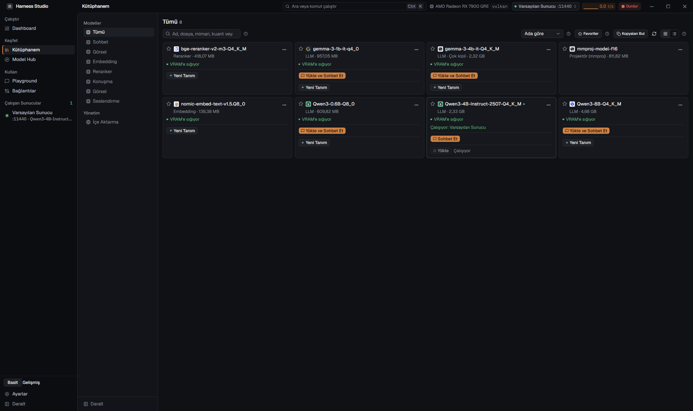
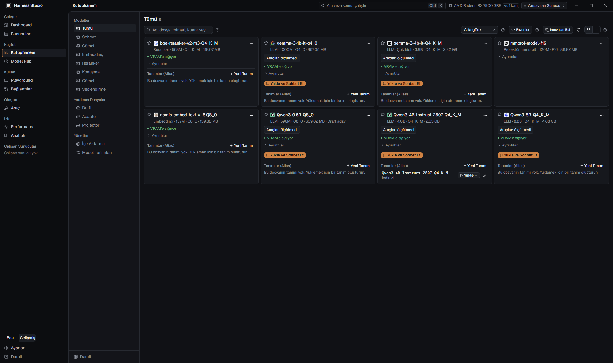
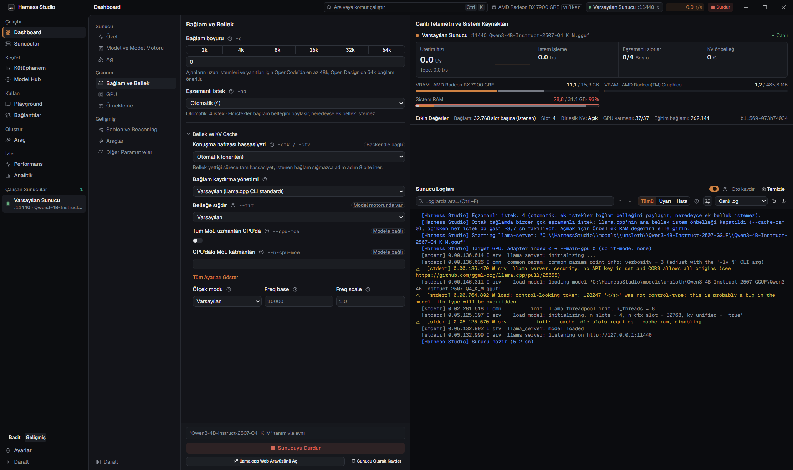
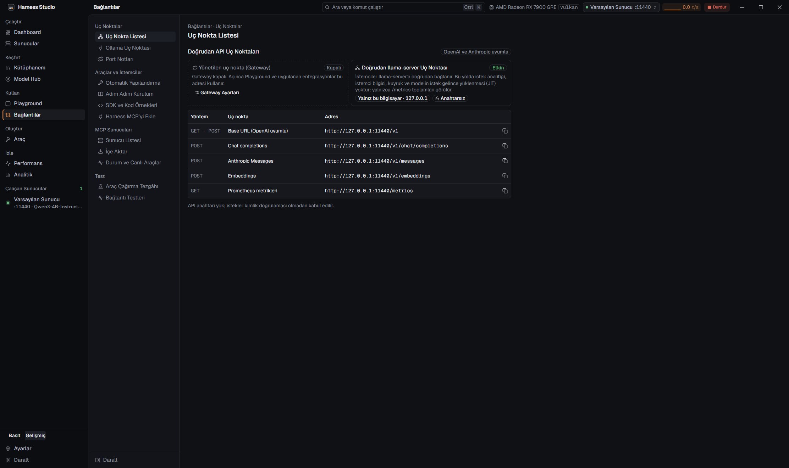
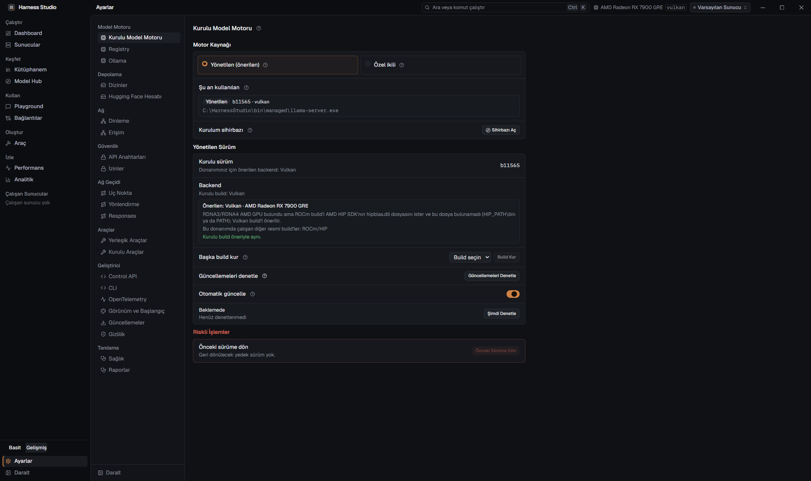

# Arayüz düzeyi (Basit / Gelişmiş) ve bilgi hiyerarşisi

[English](../en/UI_LEVELS.md)

## 1. Arka plan

- **Özellik yüzeyi geniş, katman yok.** 10 ana ekran; yalnız Dashboard'da 9, Ayarlar'da 22, Kütüphane'de 11 alt sayfa. Model seçip sohbet etmek isteyen kullanıcı da `-np`, `--fit`, `--cpu-moe`, KV önbellek kuantı, router modu, model motoru seçimi, gateway uç noktası tablosu ve MCP sunucularıyla aynı düzeyde karşılaşıyor.
- **Metin ile kontrol aynı görsel ağırlıkta.** Dashboard `Field` etiketi 12 px `font-medium`, altındaki açıklama 12 px `muted-foreground`: aradaki tek fark ağırlık ve renk tonu. `SettingRow` açıklaması her zaman satır içinde. 52 `SettingRow`, 13 `Field` satır içi açıklama taşıyor; bunlara ek olarak bileşenlere elle yazılmış 233 `text-xs text-muted-foreground` paragraf var (en çok Bağlantılar, Araç, Analitik, Ayarlar > Ağ Geçidi).
- **Teknik meta veri vurgu renginde.** "Backend'e bağlı", "Modele bağlı", "Model motorunda var" rozetleri bakır (primary) çerçeveliydi; bu, tasarım sisteminin "tek vurgu rengi" kuralına aykırıydı ve gözü asıl kontrolden alıyordu. Bayrak adları (`-c`, `--fit`) her etiketin yanında görünüyordu.
- **Altyapı hazırdı.** Alan yardımı ortak (`InfoTip`, `HelpPopover`, `FieldHelp`, `describeFields`), sayfa hiyerarşisi bildirimsel (`screenSections.ts`, `settings/sections.ts`, `Sidebar.svelte` grupları), ayarlar tek dosyada (`AppSettings`, serde varsayılanlı). Bu yüzden iki ayrı arayüz yerine tek yerden yönetilen bir görünürlük katmanı mümkündü.

## 2. Karar

İki ayrı görünüm yerine **tek arayüz, iki bilgi düzeyi** seçildi (kademeli açılım, progressive disclosure):

- İki ayrı ekran ağacı yazılmaz. Her ekran tek bileşendir. Yalnız bazı sayfa, bölüm ve alanlar **Gelişmiş** olarak işaretlenir.
- Düzey yalnız **görünürlüğü** değiştirir. Hiçbir değeri değiştirmez, sıfırlamaz ya da kaydetmez. Gizli bir ayar, Basit düzeyde de aynen uygulanır. Böylece geçişte ayar kaybı olmaz ve iki düzey arasında tutarsızlık oluşmaz.
- Metin yoğunluğu ayrı bir moda bırakılmaz, **iki düzeyde de** aynı katman kurallarıyla çözülür (bölüm 4).

Neden iki ayrı görünüm değil: Bakım yükü iki katına çıkardı. Her yeni özellik iki yerde yazılırdı ve davranışlar zamanla ayrışırdı. Kullanıcı düzey değiştirince başka bir uygulamaya geçmiş gibi olurdu. Kademeli açılımda öğe aynı yerinde kalır, Gelişmiş düzeyde yalnız fazlası görünür.

## 3. Arayüz düzeyi

### Kurallar

1. **Tek kaynak:** `AppSettings.ui_level` (`"simple"` | `"advanced"`, yoksa `null`). `null` = **Gelişmiş**: mevcut kullanıcılar güncellemeden sonra hiçbir şeyi kaybetmez. Yeni kurulumda sihirbaz sorar; önerilen seçenek **Basit**'tir.
2. **Gizlenen yer çıkmaz sokak olmaz.** Komut paleti, derin bağlantılar (`#settings/...`), hata iletisindeki "Ayarlar > X" bağlantıları ve ekranlar arası bağlantılar Gelişmiş sayfaları Basit düzeyde de açar. Bu durumda sayfanın üstünde ince bir şerit görünür: "Bu sayfa Gelişmiş düzeyde · Gelişmiş Düzeye Geç". Sayfa normal çalışır.
3. **Görünmeyen etkin ayar söylenir.** Basit düzeyde gizli kalan bir parametre varsayılandan farklıysa (ör. Dashboard'da KV önbellek tipi), ilgili yerde tek satır gösterilir: "2 gelişmiş ayar etkin · Göster". Kullanıcı neden farklı davrandığını bulabilir.
4. **Tek tıkla geçiş:** ana gezinmenin altında (Ayarlar'ın üstünde) düzey anahtarı, Ayarlar > Görünüm ve Başlangıç'ta "Arayüz düzeyi" satırı, komut paletinde "Gelişmiş Düzeye Geç" / "Basit Düzeye Geç". Geçiş anında uygulanır ve hemen kaydedilir (tema ve dil gibi).
5. **Bildirimsel işaret:** Düzey bilgisi verinin yanında durur.
   - Sayfa ve gezinme öğeleri: `SectionPage.level`, `Sidebar` `NavItem.level`, Ayarlar alt sayfaları `level`.
   - Bölüm ve alanlar: `<AdvancedOnly>` sarmalayıcısı, `SettingRow` / `SwitchRow` / `SettingGroup` / `Field` için `advanced` prop'u.
   - Varsayılan: işaretsiz öğe iki düzeyde de görünür. Yeni özellik eklerken tek karar verilir: "Bu, ilk kez yerel yapay zekâ kullanan biri için gerekli mi?" Gerekli değilse `advanced` işaretlenir.
6. **Düzey değiştirmek gezinmeyi değiştirmez.** Gelişmiş bir sayfadayken Basit'e geçilirse kullanıcı aynı sayfada kalır, sayfanın üstünde 2. kuraldaki şerit belirir. Menüden başka bir sayfaya geçince gizli sayfa listede görünmez. Kayıtlı "son sayfa" tercihi silinmez. Ekran açılırken son sayfa Basit düzeyde gizliyse ilk görünür sayfa açılır.

### Basit düzey haritası

| Ekran | Basit düzeyde görünür | Yalnız Gelişmiş |
|---|---|---|
| Ana gezinme | Dashboard, Kütüphanem, Model Hub, Playground, Bağlantılar, Ayarlar, Çalışan Sunucular | Sunucular, Araç (Oluştur), Performans, Analitik |
| Dashboard | Özet; Model (model seçici, sığma göstergesi); Bağlam ve Bellek (yalnız bağlam boyutu) | Ağ, GPU, Örnekleme, Şablon ve Reasoning, Araçlar, Diğer Parametreler; Router modu, model motoru seçici, bayrak sayısı satırı, eşzamanlı istek, KV önbellek ve tüm "Bellek ve KV Cache" bölümü; llama.cpp Web Arayüzü ve "Sunucu Olarak Kaydet" düğmeleri |
| Dashboard sağ panel | Telemetri (bellek çubukları); Sunucu Logları **kapalı katlanmış** ("Logları Göster"), hata olunca kendiliğinden açılır | Log süzgeçleri ve araç çubuğu açık |
| Playground | Sohbet ve Konuşma; giriş satırında Web ve Araçlar anahtarı, dikte (başlat/durdur, süre ve iptal); sağ panel: Model ve Preset, Sistem İstemi, Araçlar (izinler) | Embedding, Rerank sekmeleri; Örnekleme, Çıktı Sınırları, Geçmiş ve Compaction, RAG ayarları; giriş satırındaki token sayacı |
| Kütüphanem | Modeller grubu (Tümü, Sohbet, Görsel, Embedding, Reranker, Konuşma), İçe Aktarma | Yardımcı Dosyalar (Draft, Adapter, Projektör), Model Tanımları |
| Model Hub | Arama, görev süzgeci, model kartları, indirme | Ayrıntılı süzgeç paneli, kuant listesindeki teknik ayrıntılar |
| Bağlantılar | Otomatik Yapılandırma, Adım Adım Kurulum, Uç Nokta Listesi | Ollama Uç Noktası, Port Notları, SDK ve Kod Örnekleri, Harness MCP, MCP Sunucuları grubu, Test grubu |
| Ayarlar | Kurulu Model Motoru, Dizinler, Hugging Face Hesabı, Görünüm ve Başlangıç, Güncellemeler, Gizlilik | Registry, Ollama, Ağ, Güvenlik, Ağ Geçidi, Araçlar, Geliştirici, OpenTelemetry, Tanılama |

Bu tablo başlangıç sınıflandırmasıdır. Test sırasında Basit düzeyde bir akışın tamamlanamadığı görülürse ilgili öğe Basit'e alınır. Hedef akış: model bul → indir → başlat → sohbet et → bir uygulamaya bağla.

## 4. Bilgi hiyerarşisi (iki düzeyde de geçerli)

Metin silinmez. Her metin bir katmana atanır ve o katmanın görünümünü alır.

| Katman | Ne | Görünüm |
|---|---|---|
| K1 Sayfa başlığı | Seçili alt sayfanın adı | `text-base font-semibold`; sayfa açıklaması varsa tek satır `text-xs muted`, uzunsa başlığın yanındaki (?) içinde |
| K2 Bölüm başlığı | Grup adı | `text-sm font-semibold` |
| K3 Alan etiketi | Kontrolün adı | `text-sm font-medium text-foreground` (Dashboard `Field` 12 px'ten 13 px'e çıkar; etiket ile açıklama arasındaki fark büyür) |
| K4 Durum ve sonuç | Uyarı, hata, "VRAM'e sığıyor", kaydedilmemiş değişiklik, öneri ("OpenCode için en az 48k") | Her zaman satır içinde; durum rengi ve simgeyle |
| K5 Açıklama | Alanın ne işe yaradığı | **Basit:** satır içinde (`text-xs muted`), çünkü az alan kalır ve yeni kullanıcının buna ihtiyacı vardır. **Gelişmiş:** etiketin yanındaki (?) içinde. Erişilebilir açıklama (`aria-describedby`) iki düzeyde de korunur. |
| K6 Teknik ayrıntı | Bayrak adı (`-c`, `--fit`), kaynak rozetleri ("Modele bağlı", "Backend'e bağlı"), bayrak sayısı | Yalnız Gelişmiş düzeyde; nötr renkte (`text-muted-foreground`, çerçevesiz ya da `border-border`). Primary renk kullanılmaz. |

Bileşen API'si:

- `hint` = K5 açıklama: düzeye göre satır içinde ya da (?) içinde.
- `note` = K4 bağlamsal bilgi: her zaman satır içinde. Yalnız karar değiştiren ya da sonucu anlatan metinde kullanılır.
- `help` = uzun açıklama: her zaman (?) içinde.
- `flag` = K6: yalnız Gelişmiş'te, nötr mono.
- Bileşenlere elle yazılmış açıklama paragrafları (`
`) mümkün olduğunca bu üç prop'a ya da `PageIntro` bileşenine taşınır. Böylece kural tek yerden uygulanır.

## 5. Doğrulama

Düzeyler 744 sayfa görünümünde denetlendi (iki düzey × TR/EN × koyu/açık × 1440 / 900 px, izole veri klasörü). Sonuç: 0 hata, sayfa taşması yok, düzey geçişinde ayarlar korunuyor, derin bağlantı şeridi çalışıyor. Örnekler:

| Basit | Gelişmiş |
|---|---|
|  |  |

Basit düzey (solda) ilk kez kullanan biri için gerekenleri gösterir; Gelişmiş düzey (sağda) tüm ayarları açar. Diğer Gelişmiş ekranlar:

| Dashboard | Connections | Settings > Runtime |
|---|---|---|
|  |  |  |

Basit düzeyde Gelişmiş bir sayfaya derin bağlantı: sayfa normal açılır ve üstte ince bir şerit "Bu sayfa Gelişmiş düzeydedir" uyarısı gösterir.
